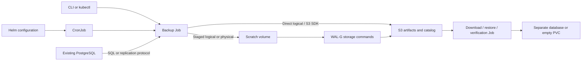

# PostgreSQL Backup for Kubernetes — development specification

**0.2 amendment:** [Logical modes](logical-modes.md) supersedes the custom-only and WAL-G-only logical transfer clauses: directory + parallel jobs and direct S3 SDK streaming are supported. All completion/consistency/offline-restore requirements remain.

Version: 1.3\
Date: 2026-11-03\
Status: version-1 acceptance contract; implementation evidence and outstanding gates are recorded in [compatibility](compatibility.md).  
Language: English, authoritative. [Russian translation](../ru/specification.md).  
Validation: [Test plan](test-plan.md).

**1.2 amendment (planned, not implemented):** REQ-043–REQ-048 add per-profile schema filters and accessible live/historical execution logs for future UI integration. This amendment extends REQ-016, REQ-038–REQ-042 and REQ-031–REQ-032. Examples of these new fields/commands are a development contract; the current worker/chart must not be described as supporting them until implementation and acceptance tests pass. The intersection policy for schema/table filters was agreed on 2026-11-03.

**1.3 amendment (agreed; local implementation):** Source portability, Yandex physical-mode exclusion, manual copy verification, status/deadline/retention semantics and staged delivery follow REQ-049–REQ-055. New implementation and PostgreSQL 18 local subcase evidence are tracked in [compatibility](compatibility.md). Historical 0.2 evidence does not certify the new behavior; full live-provider and automated gates remain separate.

## 1. Confirmed scope

**REQ-001 — Product.** Deliver an open-source Helm chart, worker images, and a CLI for backing up multiple existing PostgreSQL instances into existing S3-compatible buckets. Kubernetes is the required execution environment; source portability does not imply a standalone VM runner. Sources may be managed services, Kubernetes deployments (including Bitnami), or ordinary PostgreSQL on VMs/bare metal, reachable through supported PostgreSQL protocols. A backup of one database and a backup of an entire instance are distinct operations.

**REQ-002 — Delivery scope.** Support `logical` for both managed and self-hosted sources and conditional `physical-full` for replication-capable sources, manual/scheduled backups, listing, download, retention, restore, and restore verification. The first limited delivery targets PostgreSQL 18 by default, live Yandex Managed PostgreSQL logical backup, self-hosted PostgreSQL in Kubernetes, Yandex Object Storage, and manual verification of a specific copy by ID. Full PostgreSQL 14–18 acceptance and automated verification are later gates (REQ-055). Preserve table selection REQ-038–REQ-042 and the planned schema/log requirements REQ-043–REQ-048; this amendment neither removes them nor declares them implemented. Default retention is 30 days and two protected sets of at least three copies (REQ-026). Temporary storage is configurable, including PVCs.

**REQ-003 — Boundaries.** Version 1 excludes incremental/differential backups, continuous WAL archival, PITR, HA management, source provisioning, source upgrades, a web UI, and a Kubernetes operator/CRDs. Unsupported modes must be rejected rather than silently downgraded. Supporting PostgreSQL 14 is a compatibility commitment, not an assertion of continuing upstream maintenance.

**REQ-004 — Languages and licensing.** CLI commands, help, messages, JSON field names, configuration keys, and original documentation must be English. Specifications and all user documentation must have complete Russian translations with the same version, requirement IDs, test IDs, and examples. Translation changes ship with the English changes. Application dependencies and distributed components must use open-source licenses; produce an SBOM and notices. License for original project code: AGPL-3.0-only. WAL-G uses Apache-2.0; PostgreSQL tools use the PostgreSQL License. Final image composition and license compliance are checked in M0.

## 2. Source access contract

**REQ-005 — No source administration.** Workers must never patch source Pods, StatefulSets, Services, Secrets, PVCs, or Helm releases; mount source volumes; execute into source containers; install extensions; create users/grants; change persistent PostgreSQL settings; or create permanent replication slots. Connection/transaction-local backup settings, such as read-only mode, snapshot isolation and timeouts, are permitted. Credentials and server settings are provided externally. Source access consists of ordinary read/catalog queries, dump operations, and the standard base-backup/replication protocol. These operations can cause reads, checkpoints, locks normally taken by PostgreSQL backup tools, and temporary replication state; zero workload impact is not promised. A temporary slot used by `pg_basebackup` is allowed only for the lifetime of its connection and must disappear afterwards.

**REQ-006 — Logical eligibility.** Support explicitly named databases reachable over TCP, including managed services with limited administrative access. Existing permissions must cover connection, schemas, tables, sequences, large objects, and other exported objects. An incomplete or permission-denied dump fails the run. RLS must not silently turn a full database backup into a filtered export. Provider-owned databases and objects are not automatically included.

**REQ-007 — Physical eligibility.** Require direct replication-capable access to the intended primary, suitable existing `pg_hba.conf`, `wal_level`, WAL sender capacity, and temporary-slot capacity required by the client. SQL proxies/poolers are not supported physical endpoints. Treat physical backup of Yandex Managed PostgreSQL as unavailable due to provider access restrictions; reject it without fallback. The provider's internal WAL-G backups are not downloadable pgbk physical artifacts. Other managed sources have no promised physical support without separately proven access and recovery. WAL-G does not bypass server permissions. Report missing prerequisites without repairing them.

**REQ-008 — Preflight.** Validate configuration, DNS/connectivity, TLS, server major, requested database existence, available permissions, writable scratch storage, and S3 access. Distinguish a configuration check from a real backup: read-only checks cannot guarantee every object can be dumped or a replication connection can be accepted. Report `supported`, `unsupported`, or `unverified` with English reason codes. Neither a preflight nor a failed physical attempt automatically falls back to a logical backup. Metadata-query restrictions must not block an otherwise valid managed logical dump; record inaccessible optional metadata as unknown.

## 3. Architecture and tool roles

**REQ-009 — Components.** Kubernetes Jobs execute backup, restore, download and verification. Helm supplies profile CronJobs, immutable configuration snapshots and narrowly scoped coordination/RBAC resources, using pre-existing namespaces, identities, permissions and Leases in the normal deployment or explicitly enabled provisioning options. Manual backups use the scheduled Job template. CLI reads Kubernetes/S3 state and creates Jobs. S3 is the durable catalog; no dedicated application database or always-running application service is required. A service CronJob reconciles mandatory verification deadlines (REQ-052); it does not execute restore tests. The first delivery creates verification Jobs only on explicit manual request; scheduled verification is a later stage.



**REQ-010 — Tools.** `pg_dump` creates logical archives; `pg_restore` restores them; optional `pg_dumpall` exports global objects. `pg_basebackup` produces self-contained full physical copies, including the WAL required for their recovery. `pg_verifybackup` checks physical backup manifests. WAL-G `st put` and `st get` transfer the resulting artifacts. Listing, HEAD checks, catalog publication, and scoped deletion may use an open-source S3 SDK.

The stored artifact format is owned by this project: it is not a native WAL-G `backup-push` repository and cannot be restored with `wal-g backup-fetch`. Downloaded logical archives use `pg_restore`; physical archives are extracted and started with compatible PostgreSQL. This division must be explicit in help and user documentation.

**REQ-011 — WAL-G boundary.** Do not use WAL-G remote `backup-push` as the default physical implementation. Remote base-backup capability alone does not establish that all WAL needed for an independent recovery has been captured. Native WAL-G remote integration is a future option requiring a pinned-version proof of recovery without modifying the source or depending on an external WAL archive. WAL-G local delta functionality is outside version 1. M0 must verify `st put/get` raw-byte behavior, failures, TLS, and S3 compatibility for the chosen release.

**REQ-012 — Versions.** Select PostgreSQL client utilities of the same major version as the configured source. Refuse an unexpected server major and require an explicit configuration update. Pin all runtime images by digest and record tool versions in every manifest; never install tools at Job startup. Initial worker target is Linux amd64; other architectures require their own compatibility tests. Exact Helm, Kubernetes, Go/runtime, PostgreSQL minor, and WAL-G versions are frozen in a versioned compatibility document during M0. Kubernetes must support CronJob `spec.timeZone`; test the declared minimum and a current supported version.

## 4. Configuration contract

**REQ-013 — Entities.** Separate `targets`, `storage`, and `profiles`. A target describes an instance endpoint and existing Secret references. A profile selects one target, one backup kind, one storage destination, schedule, resource budget, retention, and optional verification. Several profiles may reference one target; each profile has exactly one backup kind. Each target has a stable `sourceId` and `concurrencyKey`; aliases for the same source use the same key. Bucket paths include an installation identity to prevent collisions between Kubernetes clusters.

The following is an illustrative values contract; the current chart exists, but planned fields require implementation and schema acceptance. The implementation must supply a JSON Schema, reject unknown fields, and document defaults and conditional requirements.

```yaml
installationId: production-cluster-a
storage:
  archive:
    bucket: pg-backups
    prefix: postgres
    endpoint: https://storage.yandexcloud.net
    region: ru-central1
    addressingStyle: path
    credentialsSecretRef: s3-backup
    tls:
      verify: true
targets:
  accounting:
    sourceId: accounting-primary
    concurrencyKey: accounting-primary
    host: postgresql.databases.svc.cluster.local
    port: 5432
    serverMajor: 18
    maintenanceDatabase: postgres
    credentialsSecretRef: accounting-backup
    tls:
      mode: verify-full
      caSecretRef: postgres-ca
profiles:
  accounting-logical:
    target: accounting
    kind: logical
    storage: archive
    logical:
      databases: [accounting]
      globals: disabled
    schedule:
      enabled: true
      cron: "0 2 * * *"
      timeZone: Europe/Moscow
      startingDeadlineSeconds: 3600
    execution:
      activeDeadlineSeconds: 21600
      resources:
        requests:
          cpu: "500m"
          memory: 512Mi
        limits:
          cpu: "2"
          memory: 2Gi
    scratch:
      type: pvc
      size: 100Gi
      storageClassName: standard
    retention:
      maxAgeDays: 30
      minSuccessfulBackups: 3
    verification:
      enabled: false
  accounting-physical:
    target: accounting
    kind: physical-full
    storage: archive
    schedule:
      enabled: false
    execution:
      resources:
        requests:
          cpu: "500m"
          memory: 512Mi
        limits:
          cpu: "2"
          memory: 2Gi
    scratch:
      type: pvc
      size: 200Gi
      storageClassName: standard
    retention:
      maxAgeDays: 30
      minSuccessfulBackups: 3
```

**REQ-014 — Secrets and TLS.** Reference pre-existing Secrets in the release namespace; do not copy source Secrets across namespaces automatically. PostgreSQL Secrets contain `username` and `password` by default; targets may override either key via `credentialsSecretKeys`; S3 Secrets contain `accessKeyId`, `secretAccessKey`, and optional `sessionToken`. CA/client-certificate references are separate and documented. Support custom CAs and PostgreSQL TLS modes, defaulting to `verify-full`; an explicit non-TLS override is allowed for known internal sources and tests. S3 certificate verification must stay enabled in production profiles. Raw credentials must not appear in values, rendered ConfigMaps, manifests, command arguments, logs, or examples. Where a tool needs environment credentials or a password file, use a restricted mount/environment only for that process. Secret rotation takes effect for new Jobs.

**REQ-015 — Defaults and validation.** Default: manual-only schedule, UTC when scheduling is enabled without a zone, `activeDeadlineSeconds=21600`, `backoffLimit=0`, `restartPolicy=Never`, `startingDeadlineSeconds=3600`, retention 30/3, logical globals disabled, serial database dumping, and bounded upload retries. Scratch size and worker CPU/memory requests/limits require explicit production values; examples are illustrative, not capacity guarantees. Support bounded `emptyDir`, dynamic scratch PVC, and existing dedicated scratch PVC. Never accept a source data PVC. Retention fields must be positive; paths and IDs must reject traversal and ambiguous prefix matches. Database names remain SQL identifiers, never shell fragments.


Per-profile retention cleanup defaults to daily at `0 4 * * *` in UTC, with explicit schedule/suspend overrides. Backup, cleanup and deadline reconciliation schedules are independent. Verification defaults to disabled; enabling manual verification requires a named environment profile, and mandatory verification additionally requires a due interval (REQ-049–REQ-053). Scheduled verification is deferred under REQ-054. Disabling verification never disables artifact integrity checks.

Every scratch workspace is isolated by run ID. Dynamic scratch PVCs belong to the run and are deleted after normal termination; failed-run retention for debugging is explicit and bounded. Existing dedicated scratch PVCs are never deleted, and concurrent Jobs must not share a writable directory. An ownership label and configured allowlist identify permitted scratch/restore PVCs; checks against mounted Pods are performed by the narrowly scoped orchestrator where necessary. If ownership or attachment state cannot be established, fail closed. A deleted API object does not prove that a remote node stopped using a volume.


## 5. Backup behavior

**REQ-016 — Logical.** Run `pg_dump` custom-format archives for an explicit nonempty database list. Per-profile schema selection follows REQ-043–REQ-045 and optional per-database table selection follows REQ-038–REQ-042. Export the ordinary full database only when neither filter applies. Publish each database as an independently downloadable file, but mark the overall run complete only when all selected databases and requested extras succeed. Dumps are consistent per database; no cross-database common snapshot is promised. Optional globals export is explicit, uses `pg_dumpall --globals-only --no-role-passwords`, and fails if requested but unavailable. Preserve archive ownership/ACL metadata; portable restore may ignore it. Record extension versions and encoding/locale where accessible. Missing extension binaries on a destination remain a restore prerequisite.

**REQ-017 — Physical.** Use `pg_basebackup` with WAL streaming, backup manifest generation, and normal durability checks. Prefer tar output with separate tablespace and WAL archives, staged on scratch. Include every required archive and mapping. Run `pg_verifybackup` using the pinned version's supported format; if extraction is required, budget the additional scratch space. Do not disable checksum validation or fsync to make a backup pass. A source promotion, timeline change, missing WAL, connection loss, or checksum failure must prevent successful publication. No retained external WAL archive may be needed to start the restored copy.

**REQ-018 — Source identity.** Record server version and, for physical mode, system identifier, timeline, and available backup start/end LSN metadata. A configured source identity unexpectedly referring to a different physical cluster must fail until explicitly acknowledged by configuration. Distinguish unavailable optional logical metadata from unsupported physical prerequisites. Preflight and post-backup identity checks must detect a changed physical source. Fixtures must test identity changes and failover; existing completed backups remain independently discoverable.

**REQ-019 — Data pipeline.** Use the staged and direct logical modes defined in the 0.2 amendment; physical-full is staged. Compute SHA-256 and byte count for every final object. Staged files use WAL-G raw `st put/get` with automatic compression/decryption/encryption disabled; direct logical streams use the S3 SDK with bounded memory. Compression is performed once by the documented producer. Future client-side encryption requires a documented contract. Require successful producer exit, archive validation, completed upload and remote integrity evidence before publication. If no trustworthy full-object provider checksum is available, re-download and hash the object; ETag alone is insufficient. Restore verification is separate from these mandatory artifact checks.

### 5.1. Logical table selection

**REQ-038 — Scope and configuration.** Logical profiles support excluding named tables and including only named tables. Configure `logical.tableSelection.byDatabase`, keyed by exact database names already listed in `logical.databases`. Databases without table rules retain ordinary logical dump behavior within the profile schema scope (REQ-043–REQ-045). Each database selection has `mode: all | selected` (default `all`), `include` and `exclude` sections. Each section accepts `tables` (an explicit list of `{schema, table}` objects), `query` (one optional SQL statement), or both. Names are exact identifiers, case-sensitive as stored in PostgreSQL; wildcard/pattern input is not supported. Each schema/table must be supplied separately, never parsed from a concatenated name. Reject table selection in `physical-full` profiles, references to unconfigured databases, and a nonempty include section in `mode: all`.

**REQ-039 — Set semantics.** For each selected database, let `I` be the union of the manually included tables and include-query results; let `E` be the union of the manually excluded tables and exclude-query results. Deduplicate by resolved relation identity. In `selected` mode, the effective table set is `I − E`. In `all` mode, use the normal pg_dump table scope minus `E`, preserving normal handling of other database objects. Exclusion always wins, including when the same relation is returned by both queries. Explicitly selecting or excluding a partitioned/inheritance parent also selects or excludes its transitive descendants; resolve descendants through PostgreSQL catalogs on every supported major version, without relying on newer pg_dump-only flags. Excluding a child never re-includes it through a parent. A selected leaf does not implicitly include its ancestors' or siblings' data.

In `selected` mode, require at least one include source and fail with `EMPTY_TABLE_SELECTION` if the final set is empty; never omit inclusion arguments and thereby dump the entire database. An empty exclude-query result is valid. In `all` mode, exclusions may leave no tables while still exporting other database objects. Fail on nonexistent names, null/empty identifiers, unsupported object kinds, or unavailable required privileges, including invalid explicit exclusions; do not silently ignore configuration mistakes. Version 1 selectors accept ordinary and partitioned user tables, including inherited tables and partitions; views, materialized views, foreign tables and system relations are not selectable through this API. Including extension-owned relations through `include.tables`/`include.query` remains unsupported. Excluding ordinary and partitioned extension-owned tables through `exclude.tables` and `exclude.query` is allowed; extension membership alone must not cause `UNSUPPORTED_RELATION`. Name existence, descendant expansion and exclusion precedence rules still apply. Such objects keep their normal upstream behavior in an unfiltered dump.

**REQ-040 — SQL-generated lists.** Run each configured query exactly once per database per backup attempt, in that database using existing source credentials; never interpret returned values as SQL, shell code or pg_dump flags. The result must have exactly two text columns named `schema_name` and `table_name`, with one relation per row. A query may read accessible catalogs or user tables. Support one read-only `SELECT`, optionally with non-writing CTEs; reject multiple statements, data-modifying CTEs, `SELECT INTO`, DDL/DML and transaction-control commands before execution. Run within a read-only transaction with a transaction-local statement timeout (default 30 seconds), a row cap (default 10,000 per query before deduplication), and bounded result memory. Reject overflow, timeout, malformed output or SQL/permission errors before starting pg_dump, with no fallback to a full dump. Query timeout and row cap are configurable under `logical.tableSelection`.

SQL is trusted administrator-provided configuration. Parser checks and a read-only transaction are not a sandbox for arbitrary functions with external side effects; only side-effect-free queries are supported. No stored functions, tables or grants are installed on the source. Do not log query text or its parameter/literal values by default; store a query/config digest and the resolved relation list for audit. Query text may live in the release configuration and must not contain credentials or other secrets. Database results are used only as identifiers, never as executable instructions.

**REQ-041 — Reproducibility and adapter behavior.** Resolve both lists and partition expansion in one read-only repeatable-read transaction per database, export its snapshot, and pass it to `pg_dump --snapshot`. Keep the coordinator transaction alive until that dump finishes; use bounded relation-lock waits to guard selected relations against concurrent DDL. If the existing endpoint/privileges cannot support the snapshot workflow, report an unsupported filtered backup rather than weaken consistency. Preflight may preview a selection, but execution always resolves its own selection again. A retry is a new backup attempt and may resolve a different set.

Map names to exact, correctly quoted pg_dump selection patterns, passing arguments without a shell. Preserve literal dots, quotes, spaces, Unicode and wildcard characters inside identifiers. Compile exclusion-only mode using exact exclusions so it retains the ordinary database-wide non-table objects; compile selected mode using exact inclusions plus exclusions. Validate the archive table contents against the resolved set, and do not mark completion if concurrent DDL causes missing, renamed or unexpectedly included tables. Record per database in the manifest/report: selection mode, manual/query provenance, normalized included/excluded/effective tables, partition expansion, resolution time, and query digests. CLI describe and download metadata must distinguish `full-database` from `filtered-database` archives; a partial archive must not be presented as a complete backup of that database. Changes between selection and dump must either respect the shared snapshot and frozen table set or fail the run.

**REQ-042 — Dependencies and filtered restore.** For ordinary tables, exclusion removes both the definition and its data; a separate data-only exclusion mode is outside this change. For extension-owned tables, exclusion prohibits dumping their data, including configuration table data listed in `pg_extension.extconfig` and registered through `pg_extension_config_dump`, and any standalone definitions of those tables emitted by pg_dump. Extension object definitions are normally created by `CREATE EXTENSION` rather than separate TABLE entries. Excluding a table does not exclude its extension, rewrite its installation SQL or prevent the table from being recreated during restore; extension handling follows the remaining dump scope. Do not silently add data from tables outside the effective set to satisfy dependencies. pg_dump table selection does not guarantee a dependency-complete archive. Document external schemas, types, functions, extensions, parent definitions and foreign-key targets that a filtered restore may require; record known prerequisites and uncertainty instead of claiming complete dependency discovery. Dependent table-owned objects follow pg_dump behavior and must be covered by tests. For `selected` mode, exclude large objects by default; optional `largeObjects: all` includes all database large objects and must be explicitly documented as broader than the table set. There is no automatic per-table large-object ownership inference. For `all` mode, normal large-object behavior is retained; excluding a table does not imply excluding large objects referenced by it.

The logical restore default remains an empty destination. For filtered archives, additionally support an explicit `destinationPolicy: prerequisites-only`: the operator pre-provisions documented schema/type/extension or referenced-table prerequisites, while the relations being restored must not already exist. This policy neither overwrites existing selected relations nor modifies the source. Dry-run/preflight reports missing known dependencies; unknown ones can still cause a clear restore failure. Restore drills use fixtures or an explicitly provisioned destination with matching prerequisites and validate the selected data scope and excluded-table absence from the archive. Ordinary full-database restore tests remain mandatory.

Selection configuration examples (fragments within a logical profile; both are normative examples of the intended schema):

```yaml
logical:
  databases: [accounting]
  globals: disabled
  tableSelection:
    queryTimeoutSeconds: 30
    maxQueryRows: 10000
    byDatabase:
      accounting:
        mode: selected
        largeObjects: none
        include:
          tables:
            - schema: public
              table: invoices
          query: |
            SELECT schemaname::text AS schema_name,
                   tablename::text AS table_name
            FROM pg_catalog.pg_tables
            WHERE schemaname = 'reporting'
        exclude:
          tables:
            - schema: reporting
              table: temporary_totals
          query: |
            SELECT schemaname::text AS schema_name,
                   tablename::text AS table_name
            FROM pg_catalog.pg_tables
            WHERE schemaname = 'reporting'
              AND tablename LIKE 'scratch_%'
```

```yaml
logical:
  databases: [accounting]
  globals: disabled
  tableSelection:
    byDatabase:
      accounting:
        mode: all
        exclude:
          tables:
            - schema: public
              table: application_logs
            - schema: public
              table: cache_entries
```

Example excluding extension-owned tables in database `ia` (normative contract; requires implementation changes):

```yaml
logical:
  databases: [ia]
  tableSelection:
    byDatabase:
      ia:
        mode: all
        exclude:
          tables:
            - schema: cron
              table: job
            - schema: cron
              table: job_run_details
```

### 5.2. Schema selection for logical backups (planned)

**REQ-043 — Per-profile schema lists.** Add `profiles.<id>.logical.schemaSelection.include` and `.exclude` as lists of exact schema names. Both default to `[]`; absent/empty include means all schemas normally considered by pg_dump, whereas a nonempty include list limits the dump to those schemas. Exclude always wins. Lists belong to each profile independently and apply to every database in that profile's `logical.databases`; targets and other profiles are unaffected. Resolve names separately in each database, without assuming identically named schemas have a common identity. A name absent in one database contributes no objects there; report unmatched names. If a nonempty include list has no effective schema left in any individual database, fail that database/run before dumping, without falling back to a full dump. Reject nulls, empty names, control characters, unknown fields and filters on physical profiles. Deduplicate names and treat case, dots, spaces, quotes, Unicode and wildcard characters literally, not as input patterns or command fragments.

Excluding extension schemas through `logical.schemaSelection.exclude` is allowed: both extension-owned schemas and ordinary schemas containing extension-owned objects. Extension membership of a schema or its tables must not cause exclusion to be rejected. For example, `schemaSelection: {exclude: [cron]}` excludes the entire `cron` schema in every profile database, including extension table data within it. This filters a schema, not an extension name; it neither requires removing the extension nor prevents its installation SQL from recreating excluded schemas/objects during restore. Allowing exclusions does not add explicit inclusion support for extension-owned tables.

```yaml
profiles:
  ia-dev-backup:
    logical:
      databases: [application]
      schemaSelection:
        include: [public, reporting]
        exclude: [reporting]
  other-backup:
    logical:
      databases: [other_application]
      schemaSelection:
        include: []
        exclude: [internal_service]
```

This is a fragment of future values; retain all other required fields. The first profile exports only `public`; the second retains ordinary dump scope except `internal_service`. Schema filters remove definitions and data, not just table contents. They do not filter `pg_dumpall` globals or physical backups, infer large-object ownership, or promise dependency-complete restoration. Requested globals remain a separate explicitly reported artifact.

**REQ-044 — Schema/table composition and adapter.** Compute schema eligibility first: all ordinary dump schemas if include is empty, otherwise schemas matching the exact include list, minus exact exclusions. For table selection, expand partition/inheritance families under REQ-039, then intersect with schema eligibility and apply table exclusions; no table include/query/parent expansion may bring back an object in a disallowed schema. Report schema-filtered table candidates, including cross-schema descendants. An explicitly named existing table outside the schema set is filtered out, not a reason to bypass the schema rule; malformed/missing explicit table names still follow REQ-039–REQ-040. An empty effective table set in `mode: selected` fails as before. Schema-only backups may validly contain schemas with no tables.

Without selected-table mode, compile exact schema filters to supported `pg_dump --schema`/`--exclude-schema` arguments, preserving ordinary behavior of non-table objects within scope and any table exclusions. When table mode is `selected`, pg_dump ignores `--schema`/`--exclude-schema` in the presence of `--table`; therefore pgbk must resolve the intersection itself and pass only the final exact table list. Never implement composition by simply appending schema flags to an unfiltered table list. Preserve selected-table mode's dependency/non-table semantics rather than promising every schema object. Use argument arrays without a shell and literal pattern quoting on PostgreSQL 14–18, in direct/staged, custom/directory and parallel modes. Do not depend on newer `--filter` or descendant flags unavailable on older supported clients.

Resolve schemas/table lists in the coordinated snapshot and protect/validate the effective object set under REQ-041. Do not read data from or acquire relation locks on excluded/out-of-scope tables merely to exclude them. Read-only catalog discovery is allowed; required catalog/query privileges and shared snapshot support remain prerequisites. Schema exclusion must work for a service-owned schema whose tables the backup user cannot read or lock, provided the permitted dump scope is otherwise accessible. Concurrent schema/table/partition DDL must preserve the declared scope or fail, never widen it.

**REQ-045 — Archive scope, large objects and restore.** Record the configured include/exclude lists, per-database resolved schemas, unmatched names, effective tables when resolved, large-object policy and prerequisites in the manifest/describe/download metadata. Any nonempty schema filter marks the archive `filtered-database`. Validate archive contents against the declared schema/table scope before completion; never publish excluded schema definitions/table data as part of an included partition family. Test views, sequences, functions, types, extensions and their dependencies according to native pg_dump behavior; do not claim schema filtering removes every database-global metadata record or rewrites references to excluded objects.

When excluding extension tables/schemas, validate the absence of corresponding standalone SCHEMA/TABLE definitions and TABLE DATA entries in the archive, including extension configuration tables. Do not require a separate TABLE entry for an object whose definition is created by an extension; checking TABLE definitions alone is insufficient to prove data exclusion. If exclusion cannot be enforced or verified, fail the run without publishing a successful backup. Test explicit table exclusion, query-based exclusion and whole-schema exclusion containing extension tables, including a configuration table with nonempty data; verify preservation of other permitted objects/data and restore that recreates excluded objects through CREATE EXTENSION without restoring excluded data. Validate exclusions using archive contents and restored data rather than requiring the absence of extension-created objects.

Add optional `logical.schemaSelection.largeObjects: none | all`. With nonempty schema include, default to `none`, matching pg_dump's schema-selection behavior; exclusion-only retains normal pg_dump large-object behavior unless explicitly overridden. With selected-table mode, retain its default `none`; reject conflicting explicit schema/table large-object policies. `all` means all database large objects, not only those referenced by included schemas/tables, and must be explicit in metadata/UI. Restore/drill follows REQ-042: dependencies outside scope are reported, never silently added to the dump. Validate exclusions in the archive, not by requiring a prerequisites-only destination to lack pre-provisioned prerequisite objects. Preflight previews and runtime selection must expose the same rules; preview is not proof of dump privileges or a promise that later execution sees identical objects.

## 6. Execution, concurrency, and status

**REQ-020 — Scheduling.** Render one CronJob per profile, with `concurrencyPolicy: Forbid` and an explicit IANA time zone. A manual-only profile has a suspended CronJob usable as a Job template. Kubernetes scheduling is at-least-once/best-effort; no exactly-once or missed-run catch-up guarantee is offered. Duplicate runs must never overwrite previous artifacts. Record scheduled time when Kubernetes supplies it, actual start/end times, and trigger (`manual`, `schedule`, or `verification`). Document daylight-saving behavior and missed scheduling deadlines.

**REQ-021 — Coordination.** Serialize backups of the same source using a renewable Kubernetes Lease keyed by `concurrencyKey`, in a declared coordination namespace. `Forbid` alone does not cover manual Jobs or different profiles. Concurrent source Jobs must report `SOURCE_BUSY` and must not start a dump. Workers fail closed and stop their subprocesses if the Lease cannot be renewed before expiry. Do not steal an expired Lease while its prior Job might still be active; require confirmed termination of the previous worker and its children, or explicit operator recovery after fencing the previous node/process. Deletion of a Job/Pod API object alone is not proof that a partitioned process has stopped. Coordinate retention and restore/download pins at repository/profile level. Multiple installations accessing one source or repository must share the same coordination domain; independent cross-cluster writers are unsupported in version 1.

**REQ-022 — Run lifecycle.** Use a collision-resistant run ID derived from Job identity plus a random component, never timestamp alone. State progression: `Pending → Preflight → BackingUp → VerifyingArtifacts → Uploading → VerifyingRemote → Completed`; terminal alternatives include `Failed`, `Cancelled`, and `SkippedBusy`. Every started run records an English reason code on failure. Kubernetes status/logs remain the failure authority when S3 is unavailable. CLI reconciles nonterminal records with Job state after crashes. `Completed` means the complete object set is published and verified, not that a restore drill has passed; expose derived copy status and verification attempts under REQ-050–REQ-052. Worker execution states are distinct from effective copy status; verification reports do not rewrite artifact completion.

**REQ-023 — Retries and cancellation.** Retry transient S3 operations with bounded exponential backoff inside the worker deadline (default five attempts per operation); do not retry authentication/configuration failures or silently resume a failed database dump. New whole-run attempts receive new IDs. On termination cancel child processes, stop uploading, release coordination only after subprocess termination, and never publish completion. Abort own multipart uploads where possible; document an external bucket rule for orphan multipart cleanup after node loss. Explicit CLI cancellation must leave discoverable status. API outages and partitions must not permit overlapping source work.

### 6.1. Accessible execution log and future UI contract (planned)

**REQ-046 — Live tool diagnostics and progress.** Capture tool stderr continuously for both streaming and staged execution, including pg_dump, pg_dumpall, pg_basebackup, pg_restore, pg_verifybackup and WAL-G. Enable supported progress/verbose output and turn it into promptly flushed structured events; pg_dump verbose messages are progress descriptions, not a reliable total or completion percentage. Keep binary archive stdout completely separate from diagnostics, including direct S3 streams. Drain subprocess output concurrently with upload/control/lease renewal using bounded memory and bounded records; slow subscribers, long/unterminated lines, non-UTF-8 output or verbose parallel workers must not deadlock a backup or suppress terminal errors. Emit periodic liveness/progress even when the tool has no output; unknown totals/percentages are null, never invented. An object-progress message is not proof that its dump succeeded.

Preserve actionable sanitized diagnostics: tool, tool exit code, database, current schema/table when reliably known, SQLSTATE when available, error class and useful explanation. `TOOL_FAILED` alone is insufficient. Apply REQ-014/REQ-032 redaction before any output or persistence: no credentials, connection secrets, raw SQL/query literals, row/dump contents or tokens; handle multiline and split-chunk secrets. Prefer parsed/template diagnostics; mark unrecognized/redacted/truncated text explicitly, retain safe context and a diagnostic reference, and never offer raw bypass as the default. Treat object names and tool output as untrusted text, not terminal/HTML instructions. Keep native stderr semantics distinct from severity: pg_dump writes normal progress to stderr too.

**REQ-047 — Simple live and historical access.** Standard worker logs must be immediately followable with `kubectl logs -f job/<job-name> -c worker -n <namespace>`, without building a debug image, creating a diagnostic Job or executing into source/worker Pods. Add `pgbk backup logs --profile ... --run-id ...` with `--follow`, `--tail`, `--since`, opaque `--after` cursor and existing text/JSON output conventions. Support explicit namespace/context. Live access uses authorized Kubernetes Pod logs; persisted run lookup uses the profile catalog. Document separate operator/UI read permissions for Job/Pod lookup and `pods/log`, without granting worker-wide Secret reads or cluster-admin.

Maintain one versioned ordered NDJSON event contract for live and historical readers, with `schemaVersion`, `runId`, `profileId`, `sourceId`, per-run `sequence`, UTC timestamp, severity, phase, event type, message and optional database/schema/table/tool/exit-code/SQLSTATE/progress fields. Distinguish unavailable metadata from absent events. Record Job/Pod identity, actual manual/scheduled trigger, start and terminal outcome. Cursor reconnect and bounded replay must permit consumers to deduplicate and detect gaps; snapshot-plus-follow must not silently lose events. Existing phase/terminal reporting remains compatible. Tool text is diagnostic data, never a machine API to parse in the future UI.

Persist sanitized logs incrementally as bounded immutable chunks with a discoverable ordered index under the exact profile/run S3 prefix, including failed and cancelled runs, without buffering the entire log or requiring successful backup publication. Run metadata exposes a log reference, completeness/gap status and timestamps. Logs must remain readable after Job/Pod TTL, with retention tied to documented profile run/diagnostic retention and existing pin/cleanup rules. Access must be scoped to the authorized installation/profile/run. S3 outage must not block local live diagnostics or lease renewal; report persistence failures/gaps and recover where possible without falsely marking incomplete logs complete. Document the recoverability limit after node loss or Pod deletion before upload. Log-only records are not usable backups and must not receive a backup completion marker.

**REQ-048 — UI-ready selection and log interfaces.** A web UI remains out of scope for this implementation, but the CLI/service adapter contract must support authorized read-only discovery of databases, exact schemas and supported tables, paginated object lists and selection preview using the same resolver as execution. Inputs/outputs must be structured identifiers, per-profile schema lists and existing per-database table lists/queries, not UI-only filters or executable command strings. Preview returns included/excluded/effective objects, provenance, dependency/large-object warnings and a configuration digest; query previews retain REQ-040 safeguards. Running Jobs keep their immutable configuration; UI edits are validated and persisted through the chosen GitOps/control path for future Jobs, never by mutating the source or silently changing an active run.

Future UI log adapters consume REQ-047 ordered events with snapshot/replay/follow, pagination/cursors, authorization and filters for run, severity, phase, tool, database, schema and table. Server-side or client-side view filters must not change the backup selection, erase stored events or alter the canonical cursor/order. Unknown object attribution stays unknown. No WebSocket/SSE transport, application server or UI implementation is required by this amendment; the event/selection contracts must allow such transports later without changing backup semantics.

## 7. S3 catalog and retention

**REQ-024 — Layout.** Use an existing bucket and an exact namespace:

```text
<prefix>/v1/<installationId>/<sourceId>/<profileId>/
  runs/<runId>/artifacts/<opaque-file-id>
  runs/<runId>/manifest.json
  runs/<runId>/complete.json
  events/<runId>/<event-id>.json
  verification/<runId>/<verification-id>.json
```

Opaque file IDs prevent unsafe database names becoming filesystem paths. The manifest maps IDs to database names, filenames, sizes, SHA-256 values, formats, source/tool versions, timestamps, backup kind, tablespaces, required restore conditions, and sanitized configuration digest. Include `schemaVersion: 1`. The success marker includes the manifest digest and is uploaded last as a single object. A marker references only immutable artifacts. CLI lists usable backups only when marker and manifest are valid; incomplete runs can be listed diagnostically. A lost response after publication must be reconciled by reading the marker, without re-running the dump or deleting a valid backup.

**REQ-025 — S3 providers.** Support configurable endpoint, region, bucket, prefix, addressing style, TLS CA, and static/temporary credentials. The same artifact layout must work on AWS S3-compatible storage and Yandex Object Storage; provider certification is recorded separately. M0 must confirm the exact WAL-G configuration mapping. Bucket-level server-side encryption can be used; support provider-specific encryption headers only after an integration test. Do not create or reconfigure buckets, IAM roles, or lifecycle policies. Physical copies may contain source-side configuration files and must be treated as sensitive data.

**REQ-026 — Retention.** Run separate scheduled/manual cleanup per profile. A completed copy is eligible only when older than `maxAgeDays` AND outside BOTH protected sets of size `minSuccessfulBackups`: newest integrity-confirmed completed copies and newest copies satisfying all requirements in their captured profile. For mandatory verification, only `verification-successful` qualifies for the second set; otherwise integrity-confirmed completion qualifies. Count by backup completion time, with run ID as a deterministic tie-breaker, never by verification time. If either set contains fewer than N copies, protect every member, including zero verified copies without discarding the integrity-confirmed safety set. Protect active operations, explicit pins and copies awaiting mandatory verification until their immutable due time; expiry removes only the waiting protection, not the two minima or active-operation protection. Optional verification awaiting manual launch adds no protection. Coordinate verification start and cleanup atomically: a deleting/deleted copy cannot start verification, and an active verification cannot be deleted. Write a deletion record and withdraw the completion marker under coordination before deleting artifacts; resume interrupted deletion idempotently. Incomplete copies require configurable grace (seven days by default) and confirmed writer termination. Delete only validated exact run prefixes. Object Lock/access denial is a cleanup failure, not a backup failure. Uninstall preserves S3 objects.

## 8. Restore, download, and verification

**REQ-027 — Download.** CLI downloads a selected completed run or one logical database archive by ID, validates marker/manifest and SHA-256, and preserves filenames safely. Local destinations must be empty or explicitly selected nonconflicting paths. Restoration must be possible from downloaded artifacts without the original Kubernetes cluster or this application's catalog service. Ship native-tool restore instructions with every format version. For managed credentials, download can run in a Job to a destination PVC instead of exposing S3 credentials locally.

**REQ-028 — Logical restore.** Restore an explicitly selected database archive to an explicitly configured separate destination database with separate credentials. Default policy requires an empty destination (with the explicit filtered-restore exception in REQ-042) and uses `pg_restore --no-owner --no-acl --exit-on-error`; arbitrary destructive clean/drop behavior is excluded from version 1. Ownership/ACL preservation is an explicit mode requiring suitable destination roles. Optional globals are never automatically executed. Require destination identity acknowledgement and reject configured source endpoints and detected source/destination identity matches. DNS aliases mean endpoint checks alone are insufficient; destinations must be administratively provisioned as isolated restore targets. A failed restore may leave partial destination objects: report this and require a newly emptied destination for retry. Operator-prepared destinations may be managed PostgreSQL, ordinary PostgreSQL on VM/bare metal, or PostgreSQL in Kubernetes; source/destination placement does not change the logical artifact format. Test both managed-to-self-hosted and supported reverse transfers with compatible versions, roles and extensions.

**REQ-029 — Physical restore.** Restore to an explicitly selected empty dedicated PVC with PostgreSQL stopped. Verify hashes, validate archive paths against traversal, extract data/WAL/tablespaces with explicit mapping, and check compatible major version, architecture/build, and extension requirements. Never overwrite a running source or attach its PVC. Sanitize restored connection/recovery settings so a test instance cannot join source replication or invoke source archival commands; preserve an audit of changed recovery-related settings without printing secrets. Source configuration stored outside PGDATA and extension binaries are separate deployment prerequisites. Product output is a prepared data directory plus restore report; production deployment is a separate operator action. Automated verification starts a disposable compatible server against the prepared data.

**REQ-030 — Restore verification.** The first delivery supports an explicit manual drill of a specific completed copy by ID, in a separate Kubernetes Job using a named verification environment profile (REQ-049–REQ-054). Scheduled/selective drills and automatic every-copy queues are later-stage features, not prerequisites for the first delivery. The default environment is disposable PostgreSQL in an isolated verification namespace, never the source. Minimum acceptance is server startup/connectivity, error-free restore, and checks of expected schemas, tables, indexes, constraints, sequences and large objects within the declared archive scope. Fixture expected-data checks are required in acceptance; user-defined read-only SQL assertions are optional in production, with no application-correctness guarantee without them. Filtered archives retain REQ-042 prerequisites. Physical drills run with source and external WAL archive unreachable. Persist versioned S3 reports with copy/attempt IDs, environment/tool/image versions, checks, timestamps, outcome and sanitized reasons. Failure must not modify the source or delete the copy; mandatory verification failure changes its effective status under REQ-050.

### 8.1. Manual verification and policy contract

**REQ-049 — Verification environment profile.** Provide named verification profiles with namespace, compatible PostgreSQL image by digest, CPU/memory budgets, storage class/size, timeout and optional read-only SQL assertions. CLI requires explicit backup profile, copy ID and verification profile, for example `pgbk verify --profile accounting-logical --run-id <run-id> --verification-profile isolated-pg18`; the manual CLI and named-environment schema are implemented locally; acceptance remains staged. Secrets are references to existing Kubernetes Secrets, never literal credentials or copied secret values. By default the Job provisions disposable isolated PostgreSQL with dedicated credentials/storage and no required source connectivity. Operators must provide extension-compatible images and prerequisites for filtered restores. Managed verification destinations, ordinary VM/bare-metal destinations and production restore clusters are prepared by the operator; the product does not provision them. Verification against managed PostgreSQL requires an explicitly configured isolated prepared target; it is not the default disposable environment.

**REQ-050 — Copy status and verification policy.** Keep artifact publication and verification outcomes separate in storage. A valid completion marker plus integrity evidence gives effective copy status `successful`, even when mandatory verification is pending. After a governing verification attempt, expose `verification-successful` or `verification-failed`. A backup profile may disable verification (default), allow optional manual verification, or require it for each copy with an explicit positive due interval from backup completion. Mandatory pending/failed copies do not meet all profile requirements even though their artifacts remain available. Optional/sample checks have their own reported outcome and do not invalidate backup success; the verification-prefixed effective status governs required verification. A required failed/overdue check makes the copy unsuccessful for profile-compliance monitoring. Never rewrite immutable artifacts, manifest or completion marker to record a check; persist reports/events separately and derive current status. Verification failure is not evidence of corruption by itself. Listing/downloading/diagnostic restore remains possible for integrity-valid copies after a failed check, with the status and reason visible.

**REQ-051 — Snapshot and retry history.** Capture nonsecret backup/verification policy and environment settings, configuration digests and Secret references when creating the copy; later profile edits do not alter old mandatory flags or deadlines. Referenced secret values may rotate and are never embedded. An explicit alternative test environment is allowed and recorded in the attempt report without relaxing the captured obligation. Persist immutable ordered attempt reports with IDs, start/end times and reasons; the latest completed attempt determines the governing verification result, while a new in-progress attempt does not clear an earlier failure. Permit late retry of an existing non-deleting copy without resetting its original due time. A later passing attempt rehabilitates the copy; expiry must not overwrite a passing result. Serialize verification per copy, returning busy and active attempt ID on a duplicate request; different copies respect an explicit shared concurrency/resource limit.

**REQ-052 — Deadline reconciliation.** Pending mandatory copies are protected until their captured due time. A service CronJob reconciles overdue obligations into `verification-failed` with a distinct overdue reason and removes waiting-only retention protection. Reads compute the same overdue state from persisted times even if the CronJob has not run. A check still pending/running at its due time is overdue; an active Job retains its operation pin and may subsequently pass. Report infrastructure/PVC/image/startup failure, incompatible environment, integrity failure, restore failure and SQL assertion failure distinctly; all failed mandatory attempts fail the requirement. Preserve attempt history and artifacts. Reconciliation and report publication use catalog coordination to prevent stale expiry from overwriting a later completed result. CLI provides an explicit reconciliation operation, planned as `pgbk verification reconcile`, which the service CronJob invokes without needing a persistent service.

**REQ-053 — Job result and cleanup.** Backup creation returns exit code 0 after successful creation/integrity publication; it does not wait for a manual check or retrospectively change its exit code. JSON separately reports effective status, pending/overdue state and profile compliance. Manual verification reports its Job/attempt identity and final outcome with existing exit-code conventions; infrastructure and restore failures remain distinguishable by reason. Save the report before normal cleanup. Delete only resources created/owned by the verification attempt after success; an explicitly configured bounded failure-debug TTL may retain them after error. Provide reconciliation/cleanup after Job or node loss. Never delete operator-provided managed instances, existing PVCs or other destination resources. Source and production endpoints remain excluded by the restore safety contract.

**REQ-054 — Later verification automation.** Keep later automatic every-copy verification and periodic selective checks distinct. Every-copy mode queues every completed copy and affects mandatory compliance; selective mode chooses the latest completed non-deleting copy at start, records/pins its ID, reports separately, and never silently substitutes it. Automation needs its own schedule/trigger, bounded concurrency/resources and queue wait/deadline controls; exceeding the mandatory deadline fails with a distinct reason. Neither mode is implemented or certified merely by documenting it. The first delivery must not require their configuration to run a manual check.

**REQ-055 — Recovery boundary and delivery gates.** Acceptance must demonstrate recovery after loss of both source and original executor Kubernetes cluster, using surviving S3 artifacts/catalog, access credentials and any required decryption keys plus a newly prepared compatible destination/executor. Do not promise survival of cloud-account loss or cross-cloud disaster without separately configured independent storage/credentials. Logical transfer is required from Yandex Managed PostgreSQL to an operator-prepared ordinary PostgreSQL 18 (VM/bare metal or Kubernetes), and between supported prepared managed/self-hosted destinations subject to extensions/roles/version prerequisites. Restoring a logical archive onto a physical server does not make it a physical backup. The first limited delivery requires real Yandex PostgreSQL 18 managed and Kubernetes-source backup/download/restore/retention and manual verification, plus self-hosted physical recovery; its evidence is separately labelled. Full release additionally requires the PostgreSQL 14–18 matrix, declared deployment integrations and later automated verification gates. Preserve planned schema filters/logs as explicitly pending gates; do not claim them shipped from this amendment or old evidence. RPO/RTO are operator objectives, not mandatory configuration fields or universal guarantees: document schedule/failure effects and measured restore durations, including operator provisioning and application cutover outside pgbk.

## 9. CLI, operations, and deployment

**REQ-031 — CLI contract.** Provide `pgbk config validate`, `pgbk preflight`, `pgbk backup run`, `pgbk backup list`, `pgbk backup describe`, `pgbk backup download`, `pgbk backup cancel`, `pgbk restore logical`, `pgbk restore physical`, `pgbk verify`, and `pgbk retention run`. All mutating operations require explicit profile/destination parameters; there is no implicit production restore target. Support readable English output and versioned `--output json`, with stable exit codes: 0 success; 2 invalid input; 3 unsupported/prerequisite failure; 4 busy; 5 execution failure; 6 integrity failure; 7 cancellation; 8 authentication/authorization failure. Native tool stderr is sanitized and attached to structured errors. CLI supports explicit Kubernetes context/namespace and timeout. Document equivalent `kubectl create job --from=cronjob/...` manual backup commands. The CLI implements manual copy-ID verification and deadline reconciliation; full delivery acceptance remains subject to the recorded gates. Backup creation and later verification have separate command outcomes (REQ-053).

**REQ-032 — Observability.** Structured JSON logs include run/profile/source IDs, phase, duration, bytes, trigger and reason code. `backup list/describe` expose artifact completion, effective copy status, verification history/latest outcome/due time, and whether all captured profile requirements are met. Monitor separately the latest integrity-confirmed copy and latest copy meeting all profile requirements; mandatory profiles require `verification-successful` for the latter. Select the freshest qualifying data snapshot, not the latest verification timestamp. Report snapshot time per database and use the earliest in a multi-database copy for conservative profile freshness; unknown snapshot time must remain unknown, with any completion-time fallback explicitly labelled. Verification never refreshes data age. Alert on stale/missing coverage, verification failures/overdue checks even with an older verified copy, and cleanup failures. Poll the durable catalog or use an external integration; short-lived Job metrics alone are insufficient. Never log secrets, password DSNs, dump contents or tokens.

**REQ-033 — Helm and RBAC.** Chart includes `values.schema.json`, documented values, image overrides/digests, resource settings, scheduling constraints, TTL/history settings, labels, optional NetworkPolicies, and Secret references. Default worker security: non-root, read-only root filesystem, dropped capabilities, and dedicated writable scratch. Workers have access only to their coordination objects and required Job status; no broad Secret API reads, source Pod exec, cluster-admin, or source workload mutation permissions. Verification and restore orchestration use separate opt-in ServiceAccounts/Roles in designated namespaces. Helm upgrades affect new Jobs through immutable configuration references; running Jobs retain their configuration. Chart hooks must not trigger backups/restores implicitly. Chart uninstall must not remove existing Secrets/PVCs or S3 data; scratch claim ownership and cleanup behavior must be documented.

**REQ-034 — Resource and failure limits.** One source is serialized; different sources may run concurrently with per-profile budgets and optionally staggered schedules. Do not promise universal throughput, compression ratios, RPO, or RTO. Measure representative backup/restore duration in CI or a benchmark environment and publish dataset/hardware/tool versions. Size scratch for artifacts plus validation extraction and restore space where relevant; fail clearly on exhausted storage. No whole-backup buffering in RAM. A six-hour deadline is a configurable default, not an availability guarantee.

## 10. Delivery plan and documentation

**REQ-035 — Milestones.** Implement in this order:

| Milestone | Deliverables and exit gate |
|---|---|
| M0: feasibility | Pin versions; confirm licensing; prove WAL-G raw transfer, self-contained pg_basebackup restore, least-privilege managed logical export, and S3 checksum strategy; freeze CLI/schema and compatibility matrix. |
| M1: catalog and runner | Configuration validation, process isolation, manifests/markers, S3 adapter, locks, cancellation, retention, and failure-injection tests. |
| M2: logical | Multi-database dumps, manual/SQL table selection, optional globals, managed-source restrictions, logical restore, integrity and restore tests. |
| M3: physical | Full copies including WAL/tablespaces, version-matched verification, isolated PVC restore, failover/error tests. |
| M4: Kubernetes | Helm chart, manual/scheduled CLI, RBAC, scratch lifecycle, Jobs coordination, and kind-based end-to-end tests. |
| M5a: limited delivery | PostgreSQL 18; live Yandex managed logical and Kubernetes-source scenarios; self-hosted physical restore; manual verification by copy ID; deadline reconciliation and dual-minimum retention; packaged artifacts and EN/RU guides. REQ-055 and first-delivery tests pass. |
| M5b: full release | PostgreSQL 14–18 matrix; Yandex live-provider test; packaged CLI/images/chart; SBOM; English/Russian docs; automatic every-copy/selective verification; declared acceptance gates pass. |

The existing implementation uses a Python CLI/worker invoking pinned utilities, Helm templates and open-source S3/Kubernetes libraries, as recorded in the [architecture decision](architecture.md). This amendment does not require a language migration. Repository layout should separate chart, runner/CLI, adapters, tests/fixtures, and bilingual documentation.

**REQ-036 — Required user documentation.** Deliver in English and Russian: quickstart; configuration reference; table inclusion/exclusion with manual and SQL examples, partition behavior and filtered-restore prerequisites; source prerequisites for generic Kubernetes/Bitnami/managed PostgreSQL; S3/Yandex setup; manual/scheduled execution; download; logical restore; physical restore; verification; retention; troubleshooting by reason code; permissions/TLS; capacity planning; compatibility and upgrade guide. Examples must use placeholders and synthetic data. Do not imply the chart configures an existing source or managed provider. Every implementation PR affecting behavior must update both languages and relevant tests.

**REQ-037 — Definition of done.** Every requirement maps to an implementation or explicitly deferred delivery stage and companion acceptance tests. A limited delivery is labelled as such, not as full PostgreSQL 14–18/automated-verification acceptance. Required release tests pass with retained reports. Backups restore from S3 with the source unavailable. No source configuration or deployment mutation is observed. Managed logical backup works without superuser privileges. English and Russian documents are synchronized. Unsupported capabilities, permission limitations, restore requirements, and any untested provider are clearly reported. No release is labeled production-ready solely on successful uploads.

## 11. References and design rationale

Original upstream references checked on 2026-10-09; Yandex backup/access documentation reviewed on 2026-11-03; M0 must verify pinned releases rather than assume development-branch behavior.

- [Yandex managed backups](https://yandex.cloud/en/docs/managed-postgresql/concepts/backup), [backup export FAQ](https://yandex.cloud/en/docs/managed-postgresql/qa/backup), and [replication slots](https://yandex.cloud/en/docs/managed-postgresql/operations/replication-slots): provider-owned WAL-G backups, no service backup download, and documented external logical replication. REQ-007 adopts the agreed unsupported-physical boundary; a role named for replication is not proof of BASE_BACKUP access.
- [PostgreSQL pg_dump](https://www.postgresql.org/docs/current/app-pgdump.html): logical export, archive formats, exact table selection and dependency limitations.
- [PostgreSQL pg_basebackup](https://www.postgresql.org/docs/current/app-pgbasebackup.html): replication prerequisites, WAL inclusion, tablespaces, and physical formats.
- [PostgreSQL pg_verifybackup](https://www.postgresql.org/docs/current/app-pgverifybackup.html): manifest verification and its limits; it does not replace a restore drill.
- [WAL-G PostgreSQL](https://wal-g.readthedocs.io/PostgreSQL/): local/remote distinction and remote delta limitations.
- [WAL-G storage tools](https://wal-g.readthedocs.io/StorageTools/): file upload/download and transformation flags.
- [WAL-G streaming implementation](https://github.com/wal-g/wal-g/blob/master/internal/databases/postgres/streaming_base_backup.go): source to inspect during the native remote feasibility investigation.
- [Kubernetes CronJobs](https://kubernetes.io/docs/concepts/workloads/controllers/cron-jobs/): scheduling, time zones, and concurrency scope.

The project-specific policies, catalog format, safety rules, and acceptance criteria above are proposed engineering requirements, not claims that upstream tools already implement them.
