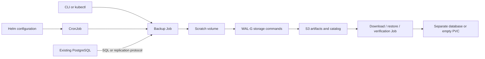

# PostgreSQL Backup for Kubernetes — development specification

**0.2 amendment:** [Logical modes](logical-modes.md) supersedes the custom-only and WAL-G-only logical transfer clauses: directory + parallel jobs and direct S3 SDK streaming are supported. All completion/consistency/offline-restore requirements remain.

Version: 1.1  
Date: 2026-10-09  
Status: version-1 acceptance contract; implementation evidence and outstanding gates are recorded in [compatibility](compatibility.md).  
Language: English, authoritative. [Russian translation](../ru/specification.md).  
Validation: [Test plan](test-plan.md).

## 1. Confirmed scope

**REQ-001 — Product.** Deliver an open-source Helm chart, worker images, and a CLI for backing up multiple existing PostgreSQL instances into existing S3-compatible buckets. Targets may be deployed with Bitnami, another chart, plain Kubernetes manifests, or managed externally. A backup of one database and a backup of an entire PostgreSQL instance are distinct operations.

**REQ-002 — Version 1.** Support `logical` and `physical-full` profiles, manual and scheduled execution, listing, download, retention, restore, and automated restore verification. Logical profiles additionally support manual and SQL-generated include/exclude table lists (REQ-038–REQ-042). Include PostgreSQL server major versions 14–18 and Yandex Object Storage in the compatibility matrix. Default retention is 30 days with at least three successful backups per profile. Temporary storage is configurable, including PVC storage.

**REQ-003 — Boundaries.** Version 1 excludes incremental/differential backups, continuous WAL archival, PITR, HA management, source provisioning, source upgrades, a web UI, and a Kubernetes operator/CRDs. Unsupported modes must be rejected rather than silently downgraded. Supporting PostgreSQL 14 is a compatibility commitment, not an assertion of continuing upstream maintenance.

**REQ-004 — Languages and licensing.** CLI commands, help, messages, JSON field names, configuration keys, and original documentation must be English. Specifications and all user documentation must have complete Russian translations with the same version, requirement IDs, test IDs, and examples. Translation changes ship with the English changes. Application dependencies and distributed components must use open-source licenses; produce an SBOM and notices. Proposed license for original project code: Apache-2.0. WAL-G uses Apache-2.0; PostgreSQL tools use the PostgreSQL License. Final image composition and license compliance are checked in M0.

## 2. Source access contract

**REQ-005 — No source administration.** Workers must never patch source Pods, StatefulSets, Services, Secrets, PVCs, or Helm releases; mount source volumes; execute into source containers; install extensions; create users/grants; change persistent PostgreSQL settings; or create permanent replication slots. Connection/transaction-local backup settings, such as read-only mode, snapshot isolation and timeouts, are permitted. Credentials and server settings are provided externally. Source access consists of ordinary read/catalog queries, dump operations, and the standard base-backup/replication protocol. These operations can cause reads, checkpoints, locks normally taken by PostgreSQL backup tools, and temporary replication state; zero workload impact is not promised. A temporary slot used by `pg_basebackup` is allowed only for the lifetime of its connection and must disappear afterwards.

**REQ-006 — Logical eligibility.** Support explicitly named databases reachable over TCP, including managed services with limited administrative access. Existing permissions must cover connection, schemas, tables, sequences, large objects, and other exported objects. An incomplete or permission-denied dump fails the run. RLS must not silently turn a full database backup into a filtered export. Provider-owned databases and objects are not automatically included.

**REQ-007 — Physical eligibility.** Require direct replication-capable access to the intended primary, suitable existing `pg_hba.conf`, `wal_level`, WAL sender capacity, and any temporary-slot capacity needed by the selected client. An ordinary SQL proxy or connection pooler is not a supported physical endpoint. Managed PostgreSQL is promised only for logical backups; physical mode is enabled only after its actual capabilities pass preflight. The worker must report missing prerequisites without attempting to fix them.

**REQ-008 — Preflight.** Validate configuration, DNS/connectivity, TLS, server major, requested database existence, available permissions, writable scratch storage, and S3 access. Distinguish a configuration check from a real backup: read-only checks cannot guarantee every object can be dumped or a replication connection can be accepted. Report `supported`, `unsupported`, or `unverified` with English reason codes. Neither a preflight nor a failed physical attempt automatically falls back to a logical backup. Metadata-query restrictions must not block an otherwise valid managed logical dump; record inaccessible optional metadata as unknown.

## 3. Architecture and tool roles

**REQ-009 — Components.** Use a Helm chart to install profile CronJobs, immutable configuration snapshots, ServiceAccounts, narrowly scoped RBAC, coordination Leases, and optional scratch PVCs. Manual execution uses the same Job template and worker as scheduled execution. A CLI creates Jobs and reads Kubernetes/S3 state. S3 is the durable backup catalog; no dedicated application database or always-running application service is required. A scheduled verification profile may create disposable PostgreSQL test instances in a designated verification namespace.



**REQ-010 — Tools.** `pg_dump` creates logical archives; `pg_restore` restores them; optional `pg_dumpall` exports global objects. `pg_basebackup` produces self-contained full physical copies, including the WAL required for their recovery. `pg_verifybackup` checks physical backup manifests. WAL-G `st put` and `st get` transfer the resulting artifacts. Listing, HEAD checks, catalog publication, and scoped deletion may use an open-source S3 SDK.

The stored artifact format is owned by this project: it is not a native WAL-G `backup-push` repository and cannot be restored with `wal-g backup-fetch`. Downloaded logical archives use `pg_restore`; physical archives are extracted and started with compatible PostgreSQL. This division must be explicit in help and user documentation.

**REQ-011 — WAL-G boundary.** Do not use WAL-G remote `backup-push` as the default physical implementation. Remote base-backup capability alone does not establish that all WAL needed for an independent recovery has been captured. Native WAL-G remote integration is a future option requiring a pinned-version proof of recovery without modifying the source or depending on an external WAL archive. WAL-G local delta functionality is outside version 1. M0 must verify `st put/get` raw-byte behavior, failures, TLS, and S3 compatibility for the chosen release.

**REQ-012 — Versions.** Select PostgreSQL client utilities of the same major version as the configured source. Refuse an unexpected server major and require an explicit configuration update. Pin all runtime images by digest and record tool versions in every manifest; never install tools at Job startup. Initial worker target is Linux amd64; other architectures require their own compatibility tests. Exact Helm, Kubernetes, Go/runtime, PostgreSQL minor, and WAL-G versions are frozen in a versioned compatibility document during M0. Kubernetes must support CronJob `spec.timeZone`; test the declared minimum and a current supported version.

## 4. Configuration contract

**REQ-013 — Entities.** Separate `targets`, `storage`, and `profiles`. A target describes an instance endpoint and existing Secret references. A profile selects one target, one backup kind, one storage destination, schedule, resource budget, retention, and optional verification. Several profiles may reference one target; each profile has exactly one backup kind. Each target has a stable `sourceId` and `concurrencyKey`; aliases for the same source use the same key. Bucket paths include an installation identity to prevent collisions between Kubernetes clusters.

The following is the intended values contract, not an implemented chart. The implementation must supply a JSON Schema, reject unknown fields, and document defaults and conditional requirements.

```yaml
installationId: production-cluster-a
storage:
  archive:
    bucket: pg-backups
    prefix: postgres
    endpoint: https://storage.yandexcloud.net
    region: ru-central1
    addressingStyle: path
    credentialsSecretRef: s3-backup
    tls:
      verify: true
targets:
  accounting:
    sourceId: accounting-primary
    concurrencyKey: accounting-primary
    host: postgresql.databases.svc.cluster.local
    port: 5432
    serverMajor: 17
    maintenanceDatabase: postgres
    credentialsSecretRef: accounting-backup
    tls:
      mode: verify-full
      caSecretRef: postgres-ca
profiles:
  accounting-logical:
    target: accounting
    kind: logical
    storage: archive
    logical:
      databases: [accounting]
      globals: disabled
    schedule:
      enabled: true
      cron: "0 2 * * *"
      timeZone: Europe/Moscow
      startingDeadlineSeconds: 3600
    execution:
      activeDeadlineSeconds: 21600
      resources:
        requests:
          cpu: "500m"
          memory: 512Mi
        limits:
          cpu: "2"
          memory: 2Gi
    scratch:
      type: pvc
      size: 100Gi
      storageClassName: standard
    retention:
      maxAgeDays: 30
      minSuccessfulBackups: 3
    verification:
      enabled: false
  accounting-physical:
    target: accounting
    kind: physical-full
    storage: archive
    schedule:
      enabled: false
    execution:
      resources:
        requests:
          cpu: "500m"
          memory: 512Mi
        limits:
          cpu: "2"
          memory: 2Gi
    scratch:
      type: pvc
      size: 200Gi
      storageClassName: standard
    retention:
      maxAgeDays: 30
      minSuccessfulBackups: 3
```

**REQ-014 — Secrets and TLS.** Reference pre-existing Secrets in the release namespace; do not copy source Secrets across namespaces automatically. PostgreSQL Secrets contain `username` and `password`; S3 Secrets contain `accessKeyId`, `secretAccessKey`, and optional `sessionToken`. CA/client-certificate references are separate and documented. Support custom CAs and PostgreSQL TLS modes, defaulting to `verify-full`; an explicit non-TLS override is allowed for known internal sources and tests. S3 certificate verification must stay enabled in production profiles. Raw credentials must not appear in values, rendered ConfigMaps, manifests, command arguments, logs, or examples. Where a tool needs environment credentials or a password file, use a restricted mount/environment only for that process. Secret rotation takes effect for new Jobs.

**REQ-015 — Defaults and validation.** Default: manual-only schedule, UTC when scheduling is enabled without a zone, `activeDeadlineSeconds=21600`, `backoffLimit=0`, `restartPolicy=Never`, `startingDeadlineSeconds=3600`, retention 30/3, logical globals disabled, serial database dumping, and bounded upload retries. Scratch size and worker CPU/memory requests/limits require explicit production values; examples are illustrative, not capacity guarantees. Support bounded `emptyDir`, dynamic scratch PVC, and existing dedicated scratch PVC. Never accept a source data PVC. Retention fields must be positive; paths and IDs must reject traversal and ambiguous prefix matches. Database names remain SQL identifiers, never shell fragments.


Per-profile retention cleanup defaults to daily at `0 4 * * *` in UTC, with explicit schedule/suspend overrides. Backup and cleanup schedules are independent. When verification is enabled, require its own schedule (or manual-only choice), destination namespace, image digest, resource/scratch limits, and timeout. A scheduled drill selects the latest completed, non-deleting backup of that profile at start, records its ID, and pins it until completion; it never silently switches to a newer backup. Disabling verification does not disable artifact integrity checks.

Every scratch workspace is isolated by run ID. Dynamic scratch PVCs belong to the run and are deleted after normal termination; failed-run retention for debugging is explicit and bounded. Existing dedicated scratch PVCs are never deleted, and concurrent Jobs must not share a writable directory. An ownership label and configured allowlist identify permitted scratch/restore PVCs; checks against mounted Pods are performed by the narrowly scoped orchestrator where necessary. If ownership or attachment state cannot be established, fail closed. A deleted API object does not prove that a remote node stopped using a volume.


## 5. Backup behavior

**REQ-016 — Logical.** Run `pg_dump` custom-format archives for an explicit nonempty database list. Optional per-database table selection follows REQ-038–REQ-042; otherwise export the ordinary full database. Publish each database as an independently downloadable file, but mark the overall run complete only when all selected databases and requested extras succeed. Dumps are consistent per database; no cross-database common snapshot is promised. Optional globals export is explicit, uses `pg_dumpall --globals-only --no-role-passwords`, and fails if requested but unavailable. Preserve archive ownership/ACL metadata; portable restore may ignore it. Record extension versions and encoding/locale where accessible. Missing extension binaries on a destination remain a restore prerequisite.

**REQ-017 — Physical.** Use `pg_basebackup` with WAL streaming, backup manifest generation, and normal durability checks. Prefer tar output with separate tablespace and WAL archives, staged on scratch. Include every required archive and mapping. Run `pg_verifybackup` using the pinned version's supported format; if extraction is required, budget the additional scratch space. Do not disable checksum validation or fsync to make a backup pass. A source promotion, timeline change, missing WAL, connection loss, or checksum failure must prevent successful publication. No retained external WAL archive may be needed to start the restored copy.

**REQ-018 — Source identity.** Record server version and, for physical mode, system identifier, timeline, and available backup start/end LSN metadata. A configured source identity unexpectedly referring to a different physical cluster must fail until explicitly acknowledged by configuration. Distinguish unavailable optional logical metadata from unsupported physical prerequisites. Preflight and post-backup identity checks must detect a changed physical source. Fixtures must test identity changes and failover; existing completed backups remain independently discoverable.

**REQ-019 — Data pipeline.** Stage completed tool output before upload. Compute SHA-256 and byte count for each final stored artifact. Compression is performed once by a documented producer/packaging step; configure WAL-G storage transfer to preserve bytes, with automatic compression/decryption/encryption disabled for this artifact contract. Any future client-side encryption requires a new documented contract. Uploads must stream from disk with bounded memory. Require successful tool exit, validation, upload completion, and remote size/checksum evidence before publishing success. If the S3 provider cannot supply a trustworthy full-object checksum, verification requires re-downloading and hashing the uploaded object; ETag alone is never a checksum substitute.

### 5.1. Logical table selection

**REQ-038 — Scope and configuration.** Logical profiles support excluding named tables and including only named tables. Configure `logical.tableSelection.byDatabase`, keyed by exact database names already listed in `logical.databases`. Unconfigured databases retain the ordinary full-database logical dump behavior. Each database selection has `mode: all | selected` (default `all`), `include` and `exclude` sections. Each section accepts `tables` (an explicit list of `{schema, table}` objects), `query` (one optional SQL statement), or both. Names are exact identifiers, case-sensitive as stored in PostgreSQL; wildcard/pattern input is not supported. Each schema/table must be supplied separately, never parsed from a concatenated name. Reject table selection in `physical-full` profiles, references to unconfigured databases, and a nonempty include section in `mode: all`.

**REQ-039 — Set semantics.** For each selected database, let `I` be the union of the manually included tables and include-query results; let `E` be the union of the manually excluded tables and exclude-query results. Deduplicate by resolved relation identity. In `selected` mode, the effective table set is `I − E`. In `all` mode, use the normal pg_dump table scope minus `E`, preserving normal handling of other database objects. Exclusion always wins, including when the same relation is returned by both queries. Explicitly selecting or excluding a partitioned/inheritance parent also selects or excludes its transitive descendants; resolve descendants through PostgreSQL catalogs on every supported major version, without relying on newer pg_dump-only flags. Excluding a child never re-includes it through a parent. A selected leaf does not implicitly include its ancestors' or siblings' data.

In `selected` mode, require at least one include source and fail with `EMPTY_TABLE_SELECTION` if the final set is empty; never omit inclusion arguments and thereby dump the entire database. An empty exclude-query result is valid. In `all` mode, exclusions may leave no tables while still exporting other database objects. Fail on nonexistent names, null/empty identifiers, unsupported object kinds, or unavailable required privileges, including invalid explicit exclusions; do not silently ignore configuration mistakes. Version 1 selectors accept ordinary and partitioned user tables, including inherited tables and partitions; views, materialized views, foreign tables, system relations and extension-owned relations are not selectable through this API. Such objects keep their normal upstream behavior in an unfiltered dump.

**REQ-040 — SQL-generated lists.** Run each configured query exactly once per database per backup attempt, in that database using existing source credentials; never interpret returned values as SQL, shell code or pg_dump flags. The result must have exactly two text columns named `schema_name` and `table_name`, with one relation per row. A query may read accessible catalogs or user tables. Support one read-only `SELECT`, optionally with non-writing CTEs; reject multiple statements, data-modifying CTEs, `SELECT INTO`, DDL/DML and transaction-control commands before execution. Run within a read-only transaction with a transaction-local statement timeout (default 30 seconds), a row cap (default 10,000 per query before deduplication), and bounded result memory. Reject overflow, timeout, malformed output or SQL/permission errors before starting pg_dump, with no fallback to a full dump. Query timeout and row cap are configurable under `logical.tableSelection`.

SQL is trusted administrator-provided configuration. Parser checks and a read-only transaction are not a sandbox for arbitrary functions with external side effects; only side-effect-free queries are supported. No stored functions, tables or grants are installed on the source. Do not log query text or its parameter/literal values by default; store a query/config digest and the resolved relation list for audit. Query text may live in the release configuration and must not contain credentials or other secrets. Database results are used only as identifiers, never as executable instructions.

**REQ-041 — Reproducibility and adapter behavior.** Resolve both lists and partition expansion in one read-only repeatable-read transaction per database, export its snapshot, and pass it to `pg_dump --snapshot`. Keep the coordinator transaction alive until that dump finishes; use bounded relation-lock waits to guard selected relations against concurrent DDL. If the existing endpoint/privileges cannot support the snapshot workflow, report an unsupported filtered backup rather than weaken consistency. Preflight may preview a selection, but execution always resolves its own selection again. A retry is a new backup attempt and may resolve a different set.

Map names to exact, correctly quoted pg_dump selection patterns, passing arguments without a shell. Preserve literal dots, quotes, spaces, Unicode and wildcard characters inside identifiers. Compile exclusion-only mode using exact exclusions so it retains the ordinary database-wide non-table objects; compile selected mode using exact inclusions plus exclusions. Validate the archive table contents against the resolved set, and do not mark completion if concurrent DDL causes missing, renamed or unexpectedly included tables. Record per database in the manifest/report: selection mode, manual/query provenance, normalized included/excluded/effective tables, partition expansion, resolution time, and query digests. CLI describe and download metadata must distinguish `full-database` from `filtered-database` archives; a partial archive must not be presented as a complete backup of that database. Changes between selection and dump must either respect the shared snapshot and frozen table set or fail the run.

**REQ-042 — Dependencies and filtered restore.** Selection excludes both the table definition and its data; excluding only table data is outside this change. Do not silently add data from tables outside the effective set to satisfy dependencies. pg_dump table selection does not guarantee a dependency-complete archive. Document external schemas, types, functions, extensions, parent definitions and foreign-key targets that a filtered restore may require; record known prerequisites and uncertainty instead of claiming complete dependency discovery. Dependent table-owned objects follow pg_dump behavior and must be covered by tests. For `selected` mode, exclude large objects by default; optional `largeObjects: all` includes all database large objects and must be explicitly documented as broader than the table set. There is no automatic per-table large-object ownership inference. For `all` mode, normal large-object behavior is retained; excluding a table does not imply excluding large objects referenced by it.

The logical restore default remains an empty destination. For filtered archives, additionally support an explicit `destinationPolicy: prerequisites-only`: the operator pre-provisions documented schema/type/extension or referenced-table prerequisites, while the relations being restored must not already exist. This policy neither overwrites existing selected relations nor modifies the source. Dry-run/preflight reports missing known dependencies; unknown ones can still cause a clear restore failure. Restore drills use fixtures or an explicitly provisioned destination with matching prerequisites and validate the selected data scope and excluded-table absence from the archive. Ordinary full-database restore tests remain mandatory.

Selection configuration examples (fragments within a logical profile; both are normative examples of the intended schema):

```yaml
logical:
  databases: [accounting]
  globals: disabled
  tableSelection:
    queryTimeoutSeconds: 30
    maxQueryRows: 10000
    byDatabase:
      accounting:
        mode: selected
        largeObjects: none
        include:
          tables:
            - schema: public
              table: invoices
          query: |
            SELECT schemaname::text AS schema_name,
                   tablename::text AS table_name
            FROM pg_catalog.pg_tables
            WHERE schemaname = 'reporting'
        exclude:
          tables:
            - schema: reporting
              table: temporary_totals
          query: |
            SELECT schemaname::text AS schema_name,
                   tablename::text AS table_name
            FROM pg_catalog.pg_tables
            WHERE schemaname = 'reporting'
              AND tablename LIKE 'scratch_%'
```

```yaml
logical:
  databases: [accounting]
  globals: disabled
  tableSelection:
    byDatabase:
      accounting:
        mode: all
        exclude:
          tables:
            - schema: public
              table: application_logs
            - schema: public
              table: cache_entries
```

## 6. Execution, concurrency, and status

**REQ-020 — Scheduling.** Render one CronJob per profile, with `concurrencyPolicy: Forbid` and an explicit IANA time zone. A manual-only profile has a suspended CronJob usable as a Job template. Kubernetes scheduling is at-least-once/best-effort; no exactly-once or missed-run catch-up guarantee is offered. Duplicate runs must never overwrite previous artifacts. Record scheduled time when Kubernetes supplies it, actual start/end times, and trigger (`manual`, `schedule`, or `verification`). Document daylight-saving behavior and missed scheduling deadlines.

**REQ-021 — Coordination.** Serialize backups of the same source using a renewable Kubernetes Lease keyed by `concurrencyKey`, in a declared coordination namespace. `Forbid` alone does not cover manual Jobs or different profiles. Concurrent source Jobs must report `SOURCE_BUSY` and must not start a dump. Workers fail closed and stop their subprocesses if the Lease cannot be renewed before expiry. Do not steal an expired Lease while its prior Job might still be active; require confirmed termination of the previous worker and its children, or explicit operator recovery after fencing the previous node/process. Deletion of a Job/Pod API object alone is not proof that a partitioned process has stopped. Coordinate retention and restore/download pins at repository/profile level. Multiple installations accessing one source or repository must share the same coordination domain; independent cross-cluster writers are unsupported in version 1.

**REQ-022 — Run lifecycle.** Use a collision-resistant run ID derived from Job identity plus a random component, never timestamp alone. State progression: `Pending → Preflight → BackingUp → VerifyingArtifacts → Uploading → VerifyingRemote → Completed`; terminal alternatives include `Failed`, `Cancelled`, and `SkippedBusy`. Every started run records an English reason code on failure. Kubernetes status/logs remain the failure authority when S3 is unavailable. CLI reconciles nonterminal records with Job state after crashes. `Completed` means the complete object set is published and verified, not that a restore drill has passed; expose restore verification separately as `not-run`, `passed`, or `failed` with timestamp.

**REQ-023 — Retries and cancellation.** Retry transient S3 operations with bounded exponential backoff inside the worker deadline (default five attempts per operation); do not retry authentication/configuration failures or silently resume a failed database dump. New whole-run attempts receive new IDs. On termination cancel child processes, stop uploading, release coordination only after subprocess termination, and never publish completion. Abort own multipart uploads where possible; document an external bucket rule for orphan multipart cleanup after node loss. Explicit CLI cancellation must leave discoverable status. API outages and partitions must not permit overlapping source work.

## 7. S3 catalog and retention

**REQ-024 — Layout.** Use an existing bucket and an exact namespace:

```text
<prefix>/v1/<installationId>/<sourceId>/<profileId>/
  runs/<runId>/artifacts/<opaque-file-id>
  runs/<runId>/manifest.json
  runs/<runId>/complete.json
  events/<runId>/<event-id>.json
  verification/<runId>/<verification-id>.json
```

Opaque file IDs prevent unsafe database names becoming filesystem paths. The manifest maps IDs to database names, filenames, sizes, SHA-256 values, formats, source/tool versions, timestamps, backup kind, tablespaces, required restore conditions, and sanitized configuration digest. Include `schemaVersion: 1`. The success marker includes the manifest digest and is uploaded last as a single object. A marker references only immutable artifacts. CLI lists usable backups only when marker and manifest are valid; incomplete runs can be listed diagnostically. A lost response after publication must be reconciled by reading the marker, without re-running the dump or deleting a valid backup.

**REQ-025 — S3 providers.** Support configurable endpoint, region, bucket, prefix, addressing style, TLS CA, and static/temporary credentials. The same artifact layout must work on AWS S3-compatible storage and Yandex Object Storage; provider certification is recorded separately. M0 must confirm the exact WAL-G configuration mapping. Bucket-level server-side encryption can be used; support provider-specific encryption headers only after an integration test. Do not create or reconfigure buckets, IAM roles, or lifecycle policies. Physical copies may contain source-side configuration files and must be treated as sensitive data.

**REQ-026 — Retention.** Run a separate scheduled/manual cleanup operation per profile. A completed backup is eligible only when older than `maxAgeDays` AND outside the newest `minSuccessfulBackups`, counted by completion time. Never delete active, pinned, or currently verified/restored/downloaded runs. Before deleting artifacts, write a deletion record and withdraw its success marker under coordination; resume interrupted deletion idempotently. Remove abandoned incomplete runs only after a configurable grace period (default seven days) and evidence that the writer has terminated. Limit deletion to validated exact run prefixes. Object Lock/denied deletion produces a visible cleanup failure and never reclassifies a successful backup as failed. Helm uninstall must leave remote objects intact.

## 8. Restore, download, and verification

**REQ-027 — Download.** CLI downloads a selected completed run or one logical database archive by ID, validates marker/manifest and SHA-256, and preserves filenames safely. Local destinations must be empty or explicitly selected nonconflicting paths. Restoration must be possible from downloaded artifacts without the original Kubernetes cluster or this application's catalog service. Ship native-tool restore instructions with every format version. For managed credentials, download can run in a Job to a destination PVC instead of exposing S3 credentials locally.

**REQ-028 — Logical restore.** Restore an explicitly selected database archive to an explicitly configured separate destination database with separate credentials. Default policy requires an empty destination (with the explicit filtered-restore exception in REQ-042) and uses `pg_restore --no-owner --no-acl --exit-on-error`; arbitrary destructive clean/drop behavior is excluded from version 1. Ownership/ACL preservation is an explicit mode requiring suitable destination roles. Optional globals are never automatically executed. Require destination identity acknowledgement and reject configured source endpoints and detected source/destination identity matches. DNS aliases mean endpoint checks alone are insufficient; destinations must be administratively provisioned as isolated restore targets. A failed restore may leave partial destination objects: report this and require a newly emptied destination for retry.

**REQ-029 — Physical restore.** Restore to an explicitly selected empty dedicated PVC with PostgreSQL stopped. Verify hashes, validate archive paths against traversal, extract data/WAL/tablespaces with explicit mapping, and check compatible major version, architecture/build, and extension requirements. Never overwrite a running source or attach its PVC. Sanitize restored connection/recovery settings so a test instance cannot join source replication or invoke source archival commands; preserve an audit of changed recovery-related settings without printing secrets. Source configuration stored outside PGDATA and extension binaries are separate deployment prerequisites. Product output is a prepared data directory plus restore report; production deployment is a separate operator action. Automated verification starts a disposable compatible server against the prepared data.

**REQ-030 — Restore verification.** Support manual and scheduled drills for both kinds in an isolated environment. Use explicit resource/storage budgets, a compatible user-selectable PostgreSQL image pinned by digest, and a deadline. Verify startup/connectivity, schemas, tables, indexes, constraints, sequences, large objects, and fixture-specific expected data within the declared archive scope. Filtered archives follow the dependency and verification rules in REQ-042; user-defined read-only assertions are optional. A physical drill must succeed while the original server and external WAL archive are unreachable. Record reports in S3 with tool/image versions and results. Verification failure must alert separately from backup failure and must never modify the source or delete the backup. Cleanup disposable resources according to a configurable failure-debug TTL.

## 9. CLI, operations, and deployment

**REQ-031 — CLI contract.** Provide `pgbk config validate`, `pgbk preflight`, `pgbk backup run`, `pgbk backup list`, `pgbk backup describe`, `pgbk backup download`, `pgbk backup cancel`, `pgbk restore logical`, `pgbk restore physical`, `pgbk verify`, and `pgbk retention run`. All mutating operations require explicit profile/destination parameters; there is no implicit production restore target. Support readable English output and versioned `--output json`, with stable exit codes: 0 success; 2 invalid input; 3 unsupported/prerequisite failure; 4 busy; 5 execution failure; 6 integrity failure; 7 cancellation; 8 authentication/authorization failure. Native tool stderr is sanitized and attached to structured errors. CLI supports explicit Kubernetes context/namespace and timeout. Document equivalent `kubectl create job --from=cronjob/...` manual backup commands. Commands are a design contract, not currently available binaries.

**REQ-032 — Observability.** Emit structured JSON logs with run/profile/source IDs, phase, duration, bytes, trigger, and reason code. Provide `backup list/describe` JSON suitable for monitoring last successful completion, backup age, duration, failures, cleanup failures, and restore verification status. Include example alerts for a missed backup freshness threshold and failed verification. An in-process metric emitted only by a short-lived Job is insufficient for backup freshness monitoring: document polling the durable catalog or a compatible external monitoring integration. Never log secrets, DSNs with passwords, dump contents, or access tokens.

**REQ-033 — Helm and RBAC.** Chart includes `values.schema.json`, documented values, image overrides/digests, resource settings, scheduling constraints, TTL/history settings, labels, optional NetworkPolicies, and Secret references. Default worker security: non-root, read-only root filesystem, dropped capabilities, and dedicated writable scratch. Workers have access only to their coordination objects and required Job status; no broad Secret API reads, source Pod exec, cluster-admin, or source workload mutation permissions. Verification and restore orchestration use separate opt-in ServiceAccounts/Roles in designated namespaces. Helm upgrades affect new Jobs through immutable configuration references; running Jobs retain their configuration. Chart hooks must not trigger backups/restores implicitly. Chart uninstall must not remove existing Secrets/PVCs or S3 data; scratch claim ownership and cleanup behavior must be documented.

**REQ-034 — Resource and failure limits.** One source is serialized; different sources may run concurrently with per-profile budgets and optionally staggered schedules. Do not promise universal throughput, compression ratios, RPO, or RTO. Measure representative backup/restore duration in CI or a benchmark environment and publish dataset/hardware/tool versions. Size scratch for artifacts plus validation extraction and restore space where relevant; fail clearly on exhausted storage. No whole-backup buffering in RAM. A six-hour deadline is a configurable default, not an availability guarantee.

## 10. Delivery plan and documentation

**REQ-035 — Milestones.** Implement in this order:

| Milestone | Deliverables and exit gate |
|---|---|
| M0: feasibility | Pin versions; confirm licensing; prove WAL-G raw transfer, self-contained pg_basebackup restore, least-privilege managed logical export, and S3 checksum strategy; freeze CLI/schema and compatibility matrix. |
| M1: catalog and runner | Configuration validation, process isolation, manifests/markers, S3 adapter, locks, cancellation, retention, and failure-injection tests. |
| M2: logical | Multi-database dumps, manual/SQL table selection, optional globals, managed-source restrictions, logical restore, integrity and restore tests. |
| M3: physical | Full copies including WAL/tablespaces, version-matched verification, isolated PVC restore, failover/error tests. |
| M4: Kubernetes | Helm chart, manual/scheduled CLI, RBAC, scratch lifecycle, Jobs coordination, and kind-based end-to-end tests. |
| M5: release | PostgreSQL 14–18 matrix; Yandex live-provider test; packaged CLI/images/chart; SBOM; English/Russian docs; all acceptance gates pass. |

Proposed implementation: Go CLI/worker invoking pinned upstream utilities as subprocesses, Helm templates, and open-source S3/Kubernetes client libraries. M0 may choose a different language only through a documented architecture decision that preserves these requirements. Repository layout should separate chart, runner/CLI, adapters, tests/fixtures, and bilingual documentation.

**REQ-036 — Required user documentation.** Deliver in English and Russian: quickstart; configuration reference; table inclusion/exclusion with manual and SQL examples, partition behavior and filtered-restore prerequisites; source prerequisites for generic Kubernetes/Bitnami/managed PostgreSQL; S3/Yandex setup; manual/scheduled execution; download; logical restore; physical restore; verification; retention; troubleshooting by reason code; permissions/TLS; capacity planning; compatibility and upgrade guide. Examples must use placeholders and synthetic data. Do not imply the chart configures an existing source or managed provider. Every implementation PR affecting behavior must update both languages and relevant tests.

**REQ-037 — Definition of done.** Every requirement maps to an implemented feature or an explicit version-1 boundary and to tests in the companion plan. Required release tests pass with retained reports. Backups restore from S3 with the source unavailable. No source configuration or deployment mutation is observed. Managed logical backup works without superuser privileges. English and Russian documents are synchronized. Unsupported capabilities, permission limitations, restore requirements, and any untested provider are clearly reported. No release is labeled production-ready solely on successful uploads.

## 11. References and design rationale

References checked on 2026-10-09; M0 must verify pinned releases rather than assume development-branch behavior.

- [PostgreSQL pg_dump](https://www.postgresql.org/docs/current/app-pgdump.html): logical export, archive formats, exact table selection and dependency limitations.
- [PostgreSQL pg_basebackup](https://www.postgresql.org/docs/current/app-pgbasebackup.html): replication prerequisites, WAL inclusion, tablespaces, and physical formats.
- [PostgreSQL pg_verifybackup](https://www.postgresql.org/docs/current/app-pgverifybackup.html): manifest verification and its limits; it does not replace a restore drill.
- [WAL-G PostgreSQL](https://wal-g.readthedocs.io/PostgreSQL/): local/remote distinction and remote delta limitations.
- [WAL-G storage tools](https://wal-g.readthedocs.io/StorageTools/): file upload/download and transformation flags.
- [WAL-G streaming implementation](https://github.com/wal-g/wal-g/blob/master/internal/databases/postgres/streaming_base_backup.go): source to inspect during the native remote feasibility investigation.
- [Kubernetes CronJobs](https://kubernetes.io/docs/concepts/workloads/controllers/cron-jobs/): scheduling, time zones, and concurrency scope.

The project-specific policies, catalog format, safety rules, and acceptance criteria above are proposed engineering requirements, not claims that upstream tools already implement them.
