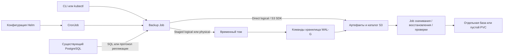

# Резервное копирование PostgreSQL в Kubernetes — спецификация разработки

**Дополнение 0.2:** [Режимы logical backup](logical-modes.md) уточняют ограничения только-custom и только-WAL-G: добавлены directory с parallel jobs и прямой поток через S3 SDK. Требования завершения, консистентности и автономного восстановления сохраняются.

Версия: 1.3\
Дата: 2026-11-03\
Статус: контракт приёмки версии 1; подтверждения реализации и открытые условия описаны в [совместимости](compatibility.md).  
Язык: русский перевод. [Нормативный английский оригинал](../en/specification.md).  
Проверка: [План тестирования](test-plan.md).

**Дополнение 1.2 (запланировано, не реализовано):** REQ-043–REQ-048 добавляют фильтры схем для каждого профиля и доступные текущие/исторические логи выполнения для будущего UI. Дополнение расширяет REQ-016, REQ-038–REQ-042 и REQ-031–REQ-032. Примеры новых полей/команд являются контрактом разработки; до реализации и прохождения приёмки нельзя описывать их как поддерживаемые текущим worker/chart. Политика пересечения фильтров схем/таблиц согласована 2026-11-03.

**Дополнение 1.3 (согласовано; локальная реализация):** Переносимость источников, запрет physical для Yandex managed, ручная проверка копии, статусы/сроки/retention и этапы поставки определены REQ-049–REQ-055. Новая реализация и локальные части испытаний PostgreSQL 18 отражены в [совместимости](compatibility.md). Исторические доказательства 0.2 не сертифицируют новое поведение; полные live-provider и автоматизированные этапы остаются отдельными.

## 1. Подтверждённый объём

**REQ-001 — Продукт.** Поставить открытые Helm-чарт, образы исполнителя и CLI для копирования нескольких существующих экземпляров PostgreSQL в существующие S3-совместимые бакеты. Kubernetes — обязательная среда исполнения; переносимость источников не означает поддержку отдельного исполнителя на VM. Источники — managed-сервисы, PostgreSQL в Kubernetes (включая Bitnami), на VM или физических серверах, доступные через поддерживаемые протоколы PostgreSQL. Копия одной базы и всего экземпляра — разные операции.

**REQ-002 — Область поставки.** Поддержать `logical` для managed и самостоятельно развёрнутых источников, условный `physical-full` при доступной репликации, ручные/плановые бэкапы, список, скачивание, retention, восстановление и его проверку. Первая ограниченная поставка ориентирована по умолчанию на PostgreSQL 18, живой logical backup Yandex Managed PostgreSQL, PostgreSQL в Kubernetes, Yandex Object Storage и ручную проверку конкретной копии по ID. Полная приёмка PostgreSQL 14–18 и автоматизация проверок — последующие этапы (REQ-055). Выбор таблиц REQ-038–REQ-042 и запланированные требования схем/логов REQ-043–REQ-048 сохраняются; дополнение не отменяет их и не объявляет реализованными. Retention по умолчанию — 30 дней и два защищённых множества минимум по три копии (REQ-026). Временное хранилище настраивается, включая PVC.

**REQ-003 — Границы.** В версию 1 не входят инкрементальные/дифференциальные копии, непрерывное архивирование WAL, PITR, управление HA, создание и обновление источников, веб-интерфейс и Kubernetes-оператор/CRD. Неподдерживаемые режимы отклоняются, а не незаметно заменяются другими. Поддержка PostgreSQL 14 означает обязательство совместимости, а не утверждение о продолжающейся поддержке этой версии разработчиками PostgreSQL.

**REQ-004 — Языки и лицензирование.** Команды CLI, справка, сообщения, имена полей JSON, ключи конфигурации и исходная документация должны быть английскими. Для спецификаций и всей пользовательской документации обязательны полные русские переводы с одинаковыми версиями, идентификаторами требований/тестов и примерами. Перевод изменяется одновременно с оригиналом. Зависимости и распространяемые компоненты должны иметь открытые лицензии; формируются SBOM и уведомления о лицензиях. Лицензия оригинального кода проекта — AGPL-3.0-only. WAL-G использует Apache-2.0, утилиты PostgreSQL — PostgreSQL License. Состав образов и соблюдение лицензий проверяются в M0.

## 2. Условия доступа к источнику

**REQ-005 — Без администрирования источника.** Исполнителю запрещено изменять исходные Pods, StatefulSets, Services, Secrets, PVC и Helm-релизы; монтировать тома источника; выполнять команды в его контейнерах; устанавливать расширения; создавать пользователей и права; менять постоянные настройки PostgreSQL; создавать постоянные replication slots. Допускаются локальные для соединения/транзакции настройки резервирования: read-only mode, snapshot isolation и timeouts. Учётные данные и настройки сервера предоставляются извне. Допустимы обычные запросы чтения/каталогов, операции дампа и стандартный протокол базового резервирования/репликации. Они могут вызывать чтение, checkpoints, обычные блокировки средств резервирования PostgreSQL и временное состояние репликации; нулевое влияние на нагрузку не обещается. Временный слот `pg_basebackup` разрешён только на время соединения и должен исчезать после его завершения.

**REQ-006 — Доступность логического режима.** Поддержать явно перечисленные базы по TCP, включая managed-сервисы с ограниченными административными правами. Существующие права должны покрывать подключение, схемы, таблицы, sequences, large objects и другие экспортируемые объекты. Неполный дамп или отказ доступа приводит к ошибке запуска. RLS не должен незаметно превращать полную копию базы в отфильтрованный экспорт. Базы и объекты, принадлежащие провайдеру, автоматически не включаются.

**REQ-007 — Доступность физического режима.** Нужны прямой доступ к выбранному primary по протоколу репликации, существующие подходящие `pg_hba.conf`, `wal_level`, лимиты WAL senders и временных слотов, требуемых клиенту. SQL-прокси/пулеры не поддерживаются как физические endpoints. Физическое резервирование Yandex Managed PostgreSQL считать недоступным из-за ограничений доступа провайдера; отклонять без fallback. Внутренние WAL-G-копии провайдера не являются скачиваемыми физическими артефактами pgbk. Другим managed-источникам физический режим не обещается без отдельного доказательства доступа и восстановления. WAL-G не обходит права сервера. Сообщать о недостающих условиях, не исправляя их.

**REQ-008 — Предварительная проверка.** Проверять конфигурацию, DNS/соединение, TLS, major-версию, существование выбранных баз, доступные права, запись во временное хранилище и доступ к S3. Отличать проверку конфигурации от реального бэкапа: проверки чтения не гарантируют доступность экспорта всех объектов или успешного replication-соединения. Результат — `supported`, `unsupported` или `unverified` с английскими кодами причин. Ни предварительная проверка, ни неудачная физическая копия не переключают запуск на логический режим. Ограничения запросов метаданных не должны блокировать допустимый логический дамп managed-базы; недоступные необязательные метаданные помечаются неизвестными.

## 3. Архитектура и роли инструментов

**REQ-009 — Компоненты.** Kubernetes Jobs выполняют бэкап, восстановление, скачивание и проверку. Helm предоставляет CronJobs профилей, неизменяемые снимки конфигурации и ограниченные ресурсы координации/RBAC; обычное развёртывание использует существующие namespace, учётные записи, права и Leases либо явно включённые опции создания. Ручной бэкап использует шаблон планового Job. CLI читает Kubernetes/S3 и создаёт Jobs. S3 — постоянный каталог; отдельная база приложения и постоянно работающий сервис не требуются. Служебный CronJob сверяет сроки обязательных проверок (REQ-052), но не выполняет тестовое восстановление. В первой поставке Jobs проверки создаются только по явному ручному запросу; расписание проверки — следующий этап.



**REQ-010 — Инструменты.** `pg_dump` создаёт логические архивы; `pg_restore` восстанавливает их; необязательный `pg_dumpall` экспортирует глобальные объекты. `pg_basebackup` создаёт самодостаточные полные физические копии вместе с необходимыми для их восстановления WAL. `pg_verifybackup` проверяет физические копии по манифесту. WAL-G `st put` и `st get` передают полученные артефакты. Просмотр списка, HEAD-проверки, публикация каталога и удаление в ограниченной области могут использовать открытый S3 SDK.

Формат хранения определяет этот проект: это не собственный репозиторий WAL-G `backup-push`, и он не восстанавливается через `wal-g backup-fetch`. Для скачанных логических архивов используется `pg_restore`; физические архивы распаковываются и запускаются совместимым PostgreSQL. Это разделение должно явно присутствовать в справке и пользовательской документации.

**REQ-011 — Граница применения WAL-G.** Не использовать remote `backup-push` WAL-G как основной физический механизм. Возможность удалённой базовой копии сама по себе не доказывает получение всех WAL для независимого восстановления. Собственная remote-интеграция WAL-G — будущий вариант, для которого нужно доказать восстановление на фиксированной версии без изменения источника и зависимости от внешнего архива WAL. Локальные delta-копии WAL-G исключены из версии 1. В M0 проверить сохранение исходных байтов через `st put/get`, ошибки, TLS и совместимость с S3 выбранного релиза.

**REQ-012 — Версии.** Выбирать утилиты PostgreSQL той же major-версии, что указана для источника. Неожиданная major-версия сервера приводит к отказу до явного обновления конфигурации. Фиксировать runtime-образы по digest и записывать версии инструментов в каждый манифест; не устанавливать инструменты при старте Job. Начальная платформа исполнителя — Linux amd64; другим архитектурам нужны отдельные проверки совместимости. Точные версии Helm, Kubernetes, Go/runtime, minor PostgreSQL и WAL-G фиксируются в версионируемом документе совместимости на M0. Kubernetes должен поддерживать CronJob `spec.timeZone`; тестируются заявленная минимальная и актуальная поддерживаемая версии.

## 4. Контракт конфигурации

**REQ-013 — Сущности.** Разделить `targets`, `storage` и `profiles`. Target описывает endpoint экземпляра и ссылки на существующие Secrets. Profile выбирает target, один тип копии, хранилище, расписание, бюджет ресурсов, retention и необязательную проверку. Несколько профилей могут ссылаться на один target; у каждого профиля ровно один тип копии. Target имеет постоянные `sourceId` и `concurrencyKey`; псевдонимы одного источника используют общий ключ. Путь в бакете включает идентификатор установки для предотвращения коллизий между Kubernetes-кластерами.

Ниже приведён иллюстративный контракт values; текущий чарт существует, но запланированные поля требуют реализации и приёмки schema. Реализация должна предоставить JSON Schema, отклонять неизвестные поля и документировать значения по умолчанию и условно обязательные параметры.

```yaml
installationId: production-cluster-a
storage:
  archive:
    bucket: pg-backups
    prefix: postgres
    endpoint: https://storage.yandexcloud.net
    region: ru-central1
    addressingStyle: path
    credentialsSecretRef: s3-backup
    tls:
      verify: true
targets:
  accounting:
    sourceId: accounting-primary
    concurrencyKey: accounting-primary
    host: postgresql.databases.svc.cluster.local
    port: 5432
    serverMajor: 18
    maintenanceDatabase: postgres
    credentialsSecretRef: accounting-backup
    tls:
      mode: verify-full
      caSecretRef: postgres-ca
profiles:
  accounting-logical:
    target: accounting
    kind: logical
    storage: archive
    logical:
      databases: [accounting]
      globals: disabled
    schedule:
      enabled: true
      cron: "0 2 * * *"
      timeZone: Europe/Moscow
      startingDeadlineSeconds: 3600
    execution:
      activeDeadlineSeconds: 21600
      resources:
        requests:
          cpu: "500m"
          memory: 512Mi
        limits:
          cpu: "2"
          memory: 2Gi
    scratch:
      type: pvc
      size: 100Gi
      storageClassName: standard
    retention:
      maxAgeDays: 30
      minSuccessfulBackups: 3
    verification:
      enabled: false
  accounting-physical:
    target: accounting
    kind: physical-full
    storage: archive
    schedule:
      enabled: false
    execution:
      resources:
        requests:
          cpu: "500m"
          memory: 512Mi
        limits:
          cpu: "2"
          memory: 2Gi
    scratch:
      type: pvc
      size: 200Gi
      storageClassName: standard
    retention:
      maxAgeDays: 30
      minSuccessfulBackups: 3
```

**REQ-014 — Secrets и TLS.** Ссылаться на существующие Secrets в namespace релиза; не копировать исходные Secrets между namespace автоматически. PostgreSQL Secret содержит `username` и `password` по умолчанию; targets могут переопределить каждый ключ через `credentialsSecretKeys`; S3 Secret — `accessKeyId`, `secretAccessKey` и необязательный `sessionToken`. Ссылки на CA/клиентские сертификаты задаются отдельно и документируются. Поддержать собственные CA и режимы TLS PostgreSQL, по умолчанию `verify-full`; явное отключение TLS допускается для известных внутренних источников и тестов. В production-профилях S3 проверка сертификата должна оставаться включённой. Пароли и ключи не должны попадать в values, ConfigMaps, манифесты, аргументы команд, логи или примеры. Если инструменту нужны секреты окружения или password file, использовать ограниченное монтирование/окружение только для этого процесса. Ротация Secrets применяется к новым Jobs.

**REQ-015 — Значения по умолчанию и валидация.** По умолчанию: только ручной запуск, UTC при включённом расписании без зоны, `activeDeadlineSeconds=21600`, `backoffLimit=0`, `restartPolicy=Never`, `startingDeadlineSeconds=3600`, retention 30/3, globals отключён, базы выгружаются последовательно, повторы загрузки ограничены. Размер временного хранилища и requests/limits CPU/памяти для production задаются явно; примеры не гарантируют достаточную ёмкость. Поддержать ограниченный `emptyDir`, динамический временный PVC и существующий выделенный временный PVC. Исходный PVC данных недопустим. Retention-поля должны быть положительными; пути и ID исключают выход за пределы каталога и неоднозначное совпадение префиксов. Имена баз остаются SQL-идентификаторами, а не фрагментами shell.

Очистка retention на профиль по умолчанию выполняется ежедневно в `0 4 * * *` UTC с явными schedule/suspend overrides. Расписания бэкапа, очистки и сверки сроков независимы. Проверка по умолчанию отключена; ручная требует именованного профиля окружения, обязательная дополнительно требует интервала до срока (REQ-049–REQ-053). Плановая проверка отложена по REQ-054. Отключение проверки восстановления не отключает контроль целостности артефактов.

Каждая рабочая область scratch изолируется по run ID. Dynamic scratch PVC принадлежит запуску и удаляется после нормального завершения; сохранение после ошибки для диагностики включается явно и ограничивается. Existing dedicated scratch PVC не удаляется; конкурирующие Jobs не используют общий writable-каталог. Ownership label и настроенный allowlist определяют разрешённые scratch/restore PVC; проверку использования Pods при необходимости выполняет оркестратор с ограниченными правами. Если владение или подключение невозможно установить, операция отклоняется. Удаление API-объекта не доказывает, что удалённый узел прекратил использование тома.


## 5. Поведение резервного копирования

**REQ-016 — Логические копии.** Создавать custom-format архивы `pg_dump` для явного непустого списка баз. Выбор схем профиля определяется REQ-043–REQ-045, необязательный выбор таблиц по базе — REQ-038–REQ-042. Обычная полная база выгружается только при отсутствии обоих фильтров. Каждая база доступна отдельным скачиваемым файлом, но запуск завершён только после успешного экспорта всех выбранных баз и дополнительных объектов. Согласованность обеспечивается отдельно для каждой базы; единый снимок разных баз не обещается. Globals включается явно, использует `pg_dumpall --globals-only --no-role-passwords` и вызывает ошибку, если запрошен, но недоступен. В архиве сохраняются ownership/ACL; переносимое восстановление может их игнорировать. Записывать версии расширений, encoding/locale, если они доступны. Наличие бинарных файлов расширений на приёмнике остаётся условием восстановления.

**REQ-017 — Физические копии.** Использовать `pg_basebackup` с WAL streaming, созданием манифеста и обычными проверками сохранности записи. Предпочтителен tar-формат с отдельными архивами tablespaces и WAL во временном хранилище. Включать все обязательные архивы и отображения путей. Выполнять `pg_verifybackup` в формате, поддерживаемом фиксированной версией; если требуется распаковка, учитывать дополнительное место. Не отключать checksum validation или fsync ради успешного завершения. Promotion источника, смена timeline, отсутствие WAL, разрыв соединения или checksum error исключают успешную публикацию. Для запуска восстановленной копии не должен требоваться сохранённый внешний архив WAL.

**REQ-018 — Идентичность источника.** Записывать версию сервера, а для физического режима — system identifier, timeline и доступные метаданные начального/конечного LSN. Если настроенная идентичность неожиданно указывает на другой физический кластер, завершаться ошибкой до явного подтверждения в конфигурации. Отличать недоступные необязательные логические метаданные от обязательных физических условий. Проверки до и после копирования должны выявлять смену физического источника. Тестовые данные должны покрывать смену идентичности и failover; ранее завершённые копии остаются доступными независимо.

**REQ-019 — Передача данных.** Использовать staged и direct logical-режимы дополнения 0.2; physical-full сохраняет staging. Для каждого итогового объекта вычислить SHA-256 и размер. Staged-файлы передавать raw-командами WAL-G `st put/get` с отключёнными автоматическими compression/decryption/encryption; direct logical использует S3 SDK при ограниченной памяти. Сжатие выполняется один раз документированным producer. Будущее клиентское шифрование требует документированного контракта. До публикации обязательны успешный exit producer, проверка архива, завершение upload и подтверждение удалённой целостности. Если нет достоверной provider checksum всего объекта, повторно скачать и хешировать; одного ETag недостаточно. Проверка восстановления отделена от обязательных проверок артефактов.

### 5.1. Выбор таблиц для логической копии

**REQ-038 — Область применения и конфигурация.** Логические профили поддерживают исключение именованных таблиц и выгрузку только именованных таблиц. Настройка `logical.tableSelection.byDatabase` задаётся по точным именам баз, уже перечисленным в `logical.databases`. Для баз без правил таблиц сохраняется обычный логический дамп в пределах фильтра схем профиля (REQ-043–REQ-045). У каждой базы есть `mode: all | selected` (по умолчанию `all`), разделы `include` и `exclude`. Каждый раздел принимает `tables` — явный список объектов `{schema, table}`, `query` — один необязательный SQL-запрос, либо оба источника. Имена — точные идентификаторы с учётом регистра хранения в PostgreSQL; шаблоны/wildcards не поддерживаются. Схема и таблица всегда задаются отдельно, без разбора склеенного имени. Отклонять фильтры в `physical-full`, ссылки на ненастроенные базы и непустой include при `mode: all`.

**REQ-039 — Правила множеств.** Для каждой базы `I` — объединение ручного include и результата include-query; `E` — объединение ручного exclude и результата exclude-query. Дубликаты удаляются по идентичности найденного relation. В режиме `selected` итоговый список равен `I − E`. В режиме `all` используется обычная область таблиц pg_dump за вычетом `E`, с сохранением обычной обработки остальных объектов базы. Исключение всегда приоритетно, в том числе если relation вернули оба запроса. Явный выбор или исключение partitioned/inheritance parent распространяется на всех его потомков; потомки определяются через каталоги PostgreSQL на каждой поддерживаемой major-версии без зависимости от новых флагов pg_dump. Исключённый child не включается повторно через parent. Выбор leaf не включает автоматически данные ancestors или siblings.

В `selected` обязателен минимум один источник include; пустое итоговое множество вызывает `EMPTY_TABLE_SELECTION`. Нельзя убирать inclusion-аргументы и тем самым выгружать всю базу. Пустой результат exclude-query допустим. В `all` после исключений могут не остаться таблицы, но выгружаются другие объекты базы. Несуществующие имена, null/пустые идентификаторы, неподдерживаемые типы объектов и недостаточные обязательные права вызывают ошибку, включая ошибочные явные исключения; ошибки конфигурации не игнорируются. В версии 1 селекторы принимают обычные и partitioned пользовательские таблицы, включая наследуемые таблицы и partitions; views, materialized views, foreign tables и system relations через этот API не выбираются. Включение extension-owned relations через `include.tables`/`include.query` остаётся неподдерживаемым. Исключение обычных и partitioned таблиц расширений разрешено через `exclude.tables` и `exclude.query`; принадлежность расширению сама по себе не является причиной `UNSUPPORTED_RELATION`. Правила существования имён, раскрытия потомков и приоритета исключений сохраняются. При дампе без фильтров эти объекты обрабатываются upstream-инструментом обычным образом.

**REQ-040 — Списки из SQL.** Каждый настроенный запрос выполняется ровно один раз на базу за попытку резервирования, в этой базе с существующими credentials источника. Полученные значения не интерпретируются как SQL, shell-код или флаги pg_dump. Результат содержит ровно два текстовых столбца `schema_name` и `table_name`, по одной relation на строку. Запрос может читать доступные каталоги или пользовательские таблицы. Допустим один read-only `SELECT`, в том числе с незаписывающими CTE; до исполнения отклонять несколько statements, data-modifying CTE, `SELECT INTO`, DDL/DML и transaction-control commands. Выполнять в read-only транзакции с локальным statement timeout, по умолчанию 30 секунд, лимитом строк, по умолчанию 10 000 на запрос до дедупликации, и ограниченной памятью результата. Превышение лимита, timeout, неверный результат, SQL/permission error останавливают запуск до pg_dump, без fallback на полный дамп. Timeout и лимит строк настраиваются в `logical.tableSelection`.

SQL — доверенная конфигурация администратора. Проверка парсером и read-only транзакция не являются изоляцией произвольных функций с внешними побочными эффектами; поддерживаются только запросы без таких эффектов. На источнике не создаются stored functions, таблицы и grants. По умолчанию не логировать текст запроса, значения параметров/литералов; для аудита сохранять query/config digest и найденный список relations. Текст запроса может храниться в конфигурации релиза и не должен содержать credentials или другие секреты. Результаты базы используются только как идентификаторы, а не исполняемые инструкции.

**REQ-041 — Воспроизводимость и адаптер.** Определять оба списка и потомков partitions в одной read-only repeatable-read транзакции на базу, экспортировать её snapshot и передавать в `pg_dump --snapshot`. Сохранять транзакцию координатора до конца дампа; использовать ограниченное ожидание relation locks для защиты выбранных relations от конкурентного DDL. Если endpoint/права не поддерживают snapshot workflow, сообщать о неподдерживаемой фильтрованной копии, не ослабляя согласованность. Preflight может показать предварительный список, но исполнение всегда получает собственный список заново. Повторная попытка — новый запуск и может получить другой состав.

Преобразовывать имена в точные корректно quoted шаблоны pg_dump и передавать argv без shell. Сохранять буквальные точки, кавычки, пробелы, Unicode и wildcard-символы внутри идентификаторов. Режим только исключений реализуется точными исключениями, сохраняя обычные объекты всей базы, не являющиеся таблицами; режим selected — точными включениями и исключениями. Проверять таблицы архива относительно вычисленного множества; не завершать копию успешно при пропавших, переименованных или неожиданно включённых таблицах из-за DDL. В манифест/отчёт по базе записывать режим, ручное/query происхождение, нормализованные include/exclude/effective lists, раскрытие partitions, время определения и query digests. CLI describe и download metadata различают `full-database` и `filtered-database`; частичный архив нельзя показывать как полную копию базы. Изменения между выбором и дампом должны либо соответствовать общему snapshot и фиксированному списку, либо приводить к ошибке запуска.

**REQ-042 — Зависимости и восстановление фильтрованной копии.** Для обычных таблиц исключение удаляет определение вместе с данными; отдельный режим исключения только данных не входит в это изменение. Для таблиц расширений исключение запрещает выгрузку их данных, включая данные конфигурационных таблиц из `pg_extension.extconfig`, зарегистрированных через `pg_extension_config_dump`, и отдельных определений этих таблиц, если pg_dump их формирует. Определения объектов расширения обычно создаются через `CREATE EXTENSION`, а не отдельными записями TABLE. Исключение таблицы не означает исключения расширения, изменения его установочного SQL или запрета повторного создания таблицы при восстановлении; расширение обрабатывается согласно остальному охвату дампа. Не добавлять незаметно данные таблиц вне итогового множества ради зависимостей. Выбор таблиц pg_dump не гарантирует полноту зависимостей архива. Документировать внешние schemas, types, functions, extensions, parent definitions и foreign-key targets, необходимые при восстановлении; записывать известные условия и неопределённость, не обещая обнаружить все зависимости. Зависимые объекты таблиц следуют поведению pg_dump и покрываются тестами. В `selected` large objects по умолчанию исключены; явный `largeObjects: all` включает все large objects базы и должен описываться как более широкий охват, чем список таблиц. Автоматического определения принадлежности large objects таблицам нет. В `all` сохраняется обычная обработка large objects; исключение таблицы не означает исключения large objects, на которые она ссылалась.

По умолчанию логическое восстановление по-прежнему требует пустого приёмника. Для фильтрованных архивов дополнительно поддержать явный `destinationPolicy: prerequisites-only`: оператор заранее создаёт документированные schema/type/extension или referenced-table prerequisites, но восстанавливаемые relations ещё не должны существовать. Политика не перезаписывает существующие выбранные relations и не меняет источник. Dry-run/preflight сообщает об известных недостающих зависимостях; неизвестные могут вызвать явную ошибку restore. Проверки восстановления используют fixtures или явно подготовленный приёмник с нужными prerequisites, сверяют область выбранных данных и отсутствие исключённых таблиц в архиве. Тесты обычного восстановления полной базы остаются обязательными.

Примеры выбора таблиц — фрагменты логического профиля; оба примера задают нормативный предполагаемый контракт схемы:

```yaml
logical:
  databases: [accounting]
  globals: disabled
  tableSelection:
    queryTimeoutSeconds: 30
    maxQueryRows: 10000
    byDatabase:
      accounting:
        mode: selected
        largeObjects: none
        include:
          tables:
            - schema: public
              table: invoices
          query: |
            SELECT schemaname::text AS schema_name,
                   tablename::text AS table_name
            FROM pg_catalog.pg_tables
            WHERE schemaname = 'reporting'
        exclude:
          tables:
            - schema: reporting
              table: temporary_totals
          query: |
            SELECT schemaname::text AS schema_name,
                   tablename::text AS table_name
            FROM pg_catalog.pg_tables
            WHERE schemaname = 'reporting'
              AND tablename LIKE 'scratch_%'
```

```yaml
logical:
  databases: [accounting]
  globals: disabled
  tableSelection:
    byDatabase:
      accounting:
        mode: all
        exclude:
          tables:
            - schema: public
              table: application_logs
            - schema: public
              table: cache_entries
```

Пример исключения таблиц расширения в базе `ia` (реализовано в 0.3.1):

```yaml
logical:
  databases: [ia]
  tableSelection:
    byDatabase:
      ia:
        mode: all
        exclude:
          tables:
            - schema: cron
              table: job
            - schema: cron
              table: job_run_details
```

### 5.2. Выбор схем для логических копий

**REQ-043 — Списки схем для каждого профиля.** Добавить `profiles.<id>.logical.schemaSelection.include` и `.exclude` как списки точных имён схем. Оба по умолчанию `[]`; отсутствующий/пустой include означает все схемы обычного охвата pg_dump, непустой include ограничивает дамп перечисленными схемами. Exclude всегда приоритетнее. Списки независимы для каждого профиля и применяются ко всем базам его `logical.databases`; targets и другие профили не меняются. Имена разрешаются отдельно в каждой базе: одинаковые имена не означают общей идентичности схем. Отсутствующее в конкретной базе имя не добавляет там объектов; несовпавшие имена отражаются в отчёте. Если непустой include не оставил ни одной итоговой схемы в какой-либо отдельной базе, завершить эту базу/запуск ошибкой до дампа, без перехода к полному дампу. Отклонять null, пустые имена, управляющие символы, неизвестные поля и фильтры в физических профилях. Устранять дубликаты; регистр, точки, пробелы, кавычки, Unicode и символы шаблонов трактовать буквально, а не как входные patterns или фрагменты команд.

Исключение схем расширений разрешено через `logical.schemaSelection.exclude`: как схем, принадлежащих расширению, так и обычных схем с объектами расширений. Принадлежность схемы или её таблиц расширению не является причиной отклонения исключения. Например, `schemaSelection: {exclude: [cron]}` исключает всю схему `cron` в каждой базе профиля, включая данные таблиц расширения в ней. Это фильтр схемы, а не имени расширения; он не требует удаления расширения и не запрещает его установочному SQL создавать исключённую схему/объекты при восстановлении. Разрешение исключений не добавляет поддержку явного включения таблиц расширений.

```yaml
profiles:
  ia-dev-backup:
    logical:
      databases: [application]
      schemaSelection:
        include: [public, reporting]
        exclude: [reporting]
  other-backup:
    logical:
      databases: [other_application]
      schemaSelection:
        include: []
        exclude: [internal_service]
```

Это фрагмент values; остальные обязательные поля сохраняются. Первый профиль экспортирует только `public`; второй сохраняет обычный охват дампа, кроме `internal_service`. Фильтры схем исключают определения и данные, а не только содержимое таблиц. Они не фильтруют globals из `pg_dumpall` или физические копии, не определяют принадлежность large objects и не гарантируют восстановление со всеми зависимостями. Запрошенные globals остаются отдельным явно обозначенным артефактом.

**REQ-044 — Совмещение схем/таблиц и адаптер.** Сначала вычислить допустимые схемы: все схемы обычного охвата дампа при пустом include, иначе схемы из точного include, за вычетом точных исключений. Для выбора таблиц раскрыть семейства partitions/inheritance по REQ-039, затем пересечь с допустимыми схемами и применить табличные исключения; ни table include/query, ни раскрытие потомков не могут вернуть объект запрещённой схемы. Сообщать о кандидатах таблиц, отсеянных фильтром схем, включая потомков в других схемах. Явно названная существующая таблица вне допустимых схем отфильтровывается, а не обходит правило схем; неверные/отсутствующие явно заданные таблицы по-прежнему обрабатываются по REQ-039–REQ-040. Пустое итоговое множество в `mode: selected` остаётся ошибкой. Выбор только схем может корректно содержать схемы без таблиц.

Без режима выбранных таблиц преобразовывать точные фильтры схем в поддерживаемые аргументы `pg_dump --schema`/`--exclude-schema`, сохраняя обычное поведение нетабличных объектов в пределах охвата и табличных исключений. В табличном режиме `selected` pg_dump игнорирует `--schema`/`--exclude-schema` при наличии `--table`; поэтому pgbk обязан сам вычислить пересечение и передать только итоговый точный список таблиц. Нельзя реализовать совмещение простым добавлением флагов схем к неотфильтрованному списку таблиц. Сохранять семантику зависимостей/нетабличных объектов selected-режима, не обещая включить все объекты схемы. Использовать массивы аргументов без shell и буквальный pattern quoting на PostgreSQL 14–18, в direct/staged, custom/directory и parallel-режимах. Не зависеть от новых `--filter` или флагов потомков, отсутствующих в старых поддерживаемых клиентах.

Разрешать схемы/списки таблиц в согласованном snapshot, защищать и проверять итоговый состав по REQ-041. Не читать данные и не брать relation locks на исключённых таблицах или таблицах вне охвата лишь для их исключения. Допустимо чтение каталогов; необходимые права на каталоги/запросы и поддержка общего snapshot остаются условиями. Исключение должно работать для служебной схемы, таблицы которой backup-пользователь не может читать или блокировать, если разрешённый охват дампа доступен. Конкурентные DDL схем/таблиц/partitions должны сохранять заявленный охват либо приводить к ошибке, но не расширять его.

**REQ-045 — Охват архива, large objects и восстановление.** Записывать настроенные include/exclude, разрешённые схемы каждой базы, несовпавшие имена, итоговые таблицы при их разрешении, политику large objects и prerequisites в manifest/describe/download metadata. Любой непустой фильтр схем помечает архив `filtered-database`. Проверять содержимое архива на соответствие заявленному охвату схем/таблиц до завершения; не публиковать определения исключённых схем/данные их таблиц как часть включённого partition family. Проверять views, sequences, functions, types, extensions и зависимости согласно поведению pg_dump; не обещать, что фильтр схем удалит каждую запись общебазовых метаданных или перепишет ссылки на исключённые объекты.

При исключении таблиц/схем расширений проверять отсутствие соответствующих отдельных определений SCHEMA/TABLE и записей TABLE DATA в архиве, включая конфигурационные таблицы расширения. Не требовать отдельной записи TABLE для объекта, определение которого создаётся расширением; одной проверки определений TABLE недостаточно для подтверждения исключения данных. Невозможность обеспечить или проверить исключение завершает запуск ошибкой без публикации успешной копии. Покрыть тестами явное исключение таблицы, исключение через query и исключение целой схемы с таблицами расширения, в том числе конфигурационной таблицей с непустыми данными; проверить сохранение остальных разрешённых объектов/данных и восстановление с повторным созданием исключённых объектов через CREATE EXTENSION без восстановления исключённых данных. Исключения проверяются по архиву и восстановленным данным, а не по обязательному отсутствию объектов, создаваемых расширением.

Добавить необязательный `logical.schemaSelection.largeObjects: none | all`. При непустом include схем по умолчанию `none`, согласно schema-selection поведению pg_dump; exclusion-only сохраняет обычное поведение pg_dump для large objects, если оно явно не переопределено. В selected-режиме таблиц сохраняется его default `none`; конфликтующие явные политики large objects схем/таблиц отклоняются. `all` означает все large objects базы, а не только используемые выбранными схемами/таблицами, и явно отражается в metadata/UI. Restore/drill следует REQ-042: зависимости вне охвата перечисляются, но не добавляются незаметно в дамп. Проверять исключения в архиве, не требуя отсутствия заранее подготовленных prerequisites в prerequisites-only назначении. Preflight preview и реальный отбор используют одинаковые правила; preview не доказывает права дампа и не обещает идентичный состав при последующем выполнении.

## 6. Запуск, параллелизм и статус

**REQ-020 — Расписание.** Создавать один CronJob на профиль с `concurrencyPolicy: Forbid` и явной IANA time zone. Профиль без расписания имеет suspended CronJob для использования как Job template. Планирование Kubernetes работает по модели at-least-once/best-effort; гарантия exactly-once или выполнения всех пропущенных запусков не предоставляется. Дубли не должны перезаписывать прежние артефакты. Записывать плановое время, если оно предоставлено Kubernetes, фактическое начало/окончание и trigger (`manual`, `schedule`, `verification`). Документировать переходы летнего времени и пропущенные scheduling deadlines.

**REQ-021 — Координация.** Последовательно выполнять копии одного источника через возобновляемый Kubernetes Lease по `concurrencyKey` в указанном namespace координации. Одного `Forbid` недостаточно для ручных Jobs и разных профилей. Конкурирующие Jobs сообщают `SOURCE_BUSY` и не начинают дамп. Если Lease нельзя продлить до истечения срока, исполнитель прекращает дочерние процессы и работу. Не перехватывать просроченный Lease, пока прежний Job потенциально активен: нужно подтверждение остановки прежнего исполнителя и дочерних процессов либо явное восстановление оператором после изоляции прежнего узла/процесса. Удаление API-объекта Job/Pod само по себе не доказывает остановку процесса при сетевом разделении. На уровне репозитория/профиля координировать retention и закрепления restore/download. Несколько установок для одного источника/репозитория обязаны использовать общую область координации; независимые писатели из разных кластеров не поддерживаются в версии 1.

**REQ-022 — Жизненный цикл.** Использовать устойчивый к коллизиям run ID на основе идентичности Job и случайной части, не одного timestamp. Последовательность: `Pending → Preflight → BackingUp → VerifyingArtifacts → Uploading → VerifyingRemote → Completed`; альтернативные конечные состояния — `Failed`, `Cancelled`, `SkippedBusy`. Каждый начавшийся запуск при ошибке получает английский reason code. Если S3 недоступен, источником информации об ошибках остаются Kubernetes status/logs. После сбоев CLI сопоставляет незавершённые записи с состоянием Jobs. `Completed` означает проверку и публикацию полного комплекта объектов, а не успешное тестовое восстановление; итоговый статус и попытки проверки определены REQ-050–REQ-052. Состояние worker отличается от итогового статуса копии; отчёты проверки не переписывают завершение артефактов.

**REQ-023 — Повторы и отмена.** Временные ошибки S3 повторять с ограниченной экспоненциальной задержкой в пределах deadline исполнителя; по умолчанию пять попыток на операцию. Не повторять ошибки аутентификации/конфигурации и не продолжать незаметно неудачный дамп. Новая попытка всего запуска получает новый ID. При завершении отменить дочерние процессы и загрузку, освобождать координацию только после остановки процессов, не публиковать успех. По возможности прерывать собственные multipart uploads; документировать внешнее bucket-правило очистки незавершённых uploads после потери узла. Явная отмена CLI должна оставлять доступный статус. Недоступность API и сетевые разделения не должны разрешать одновременную работу с источником.

### 6.1. Доступный лог выполнения и контракт будущего UI (запланировано)

**REQ-046 — Текущая диагностика инструментов и прогресс.** Непрерывно читать stderr инструментов в streaming и staged выполнении, включая pg_dump, pg_dumpall, pg_basebackup, pg_restore, pg_verifybackup и WAL-G. Включать поддерживаемый progress/verbose вывод и преобразовывать его в оперативно сбрасываемые структурированные события; verbose-сообщения pg_dump описывают прогресс, но не дают надёжного общего объёма или процента завершения. Полностью отделить бинарный stdout архива от диагностики, в том числе при прямом потоке в S3. Читать вывод subprocesses параллельно с upload/control/обновлением Lease, с ограниченной памятью и размером записей; медленные подписчики, длинные/незавершённые строки, не-UTF-8 вывод и verbose parallel workers не должны вызывать deadlock бэкапа или подавлять конечные ошибки. Периодически сообщать о работоспособности/прогрессе даже при молчащем инструменте; неизвестные общие объёмы/проценты — null, не выдуманные значения. Сообщение об обработке объекта не доказывает успешность его дампа.

Сохранять полезную очищенную диагностику: инструмент, его exit code, базу, текущую схему/таблицу при надёжном определении, SQLSTATE при наличии, класс ошибки и полезное объяснение. Одного `TOOL_FAILED` недостаточно. Применять очистку REQ-014/REQ-032 до любого вывода или сохранения: никаких credentials, секретов подключения, raw SQL/литералов запросов, содержимого строк/дампов или токенов; учитывать многострочные секреты и разрывы между chunks. Предпочитать разобранную/шаблонную диагностику; явно обозначать неизвестный/скрытый/обрезанный текст, сохранять безопасный контекст и диагностическую ссылку, не предоставлять raw bypass по умолчанию. Имена объектов и вывод инструментов — недоверенный текст, а не terminal/HTML инструкции. Не отождествлять stderr с уровнем ошибки: pg_dump пишет туда и обычный прогресс.

**REQ-047 — Простой доступ к текущему и историческому логу.** Штатный лог worker должен сразу читаться через `kubectl logs -f job/<job-name> -c worker -n <namespace>`, без сборки debug-образа, создания диагностического Job или exec в Pod источника/worker. Добавить `pgbk backup logs --profile ... --run-id ...` с `--follow`, `--tail`, `--since`, непрозрачным курсором `--after` и существующими соглашениями text/JSON. Поддержать явные namespace/context. Текущий доступ использует разрешённый Kubernetes Pod logs; поиск сохранённого запуска — каталог профиля. Документировать отдельные read-права оператора/UI для поиска Job/Pod и `pods/log`, без широкого чтения Secret исполнителем или cluster-admin.

Поддержать один версионированный упорядоченный NDJSON-контракт событий для текущего и исторического чтения: `schemaVersion`, `runId`, `profileId`, `sourceId`, возрастающий в пределах запуска `sequence`, UTC timestamp, severity, phase, event type, message и необязательные database/schema/table/tool/exit-code/SQLSTATE/progress поля. Отличать недоступные метаданные от отсутствия событий. Записывать Job/Pod identity, фактический manual/scheduled trigger, начало и конечный исход. Переподключение с курсором и ограниченный replay позволяют устранять дубли и обнаруживать пропуски; snapshot-plus-follow не должен незаметно терять события. Сохранять совместимость существующих phase/terminal отчётов. Текст инструментов — диагностические данные, а не машинный API для разбора будущим UI.

Сохранять очищенные логи по мере выполнения ограниченными неизменяемыми chunks с доступным упорядоченным индексом в точном S3 prefix профиля/запуска, в том числе для Failed и Cancelled, без буферизации всего лога и без требования успешной публикации копии. Метаданные запуска содержат ссылку на лог, полноту/пропуски и timestamps. Логи доступны после TTL Job/Pod; retention связан с документированной политикой хранения запусков/диагностики профиля и существующими правилами pin/cleanup. Доступ ограничен разрешёнными installation/profile/run. Недоступность S3 не блокирует локальную live-диагностику и обновление Lease; сообщать о сбоях сохранения/пропусках и восстанавливать сохранение по возможности, не представляя неполный лог полным. Документировать предел восстановления после потери узла или удаления Pod до upload. Записи только с логами не являются пригодными копиями и не получают backup completion marker.

**REQ-048 — Интерфейсы выбора и логов для будущего UI.** Веб-интерфейс остаётся вне текущей реализации, но контракт CLI/service adapter должен поддерживать разрешённое read-only обнаружение баз, точных схем и поддерживаемых таблиц, постраничные списки объектов и preview отбора через тот же resolver, что используется при выполнении. Входы/выходы — структурированные идентификаторы, списки схем профиля и существующие per-database списки/запросы таблиц, а не UI-only фильтры или строки исполняемых команд. Preview возвращает включённые/исключённые/итоговые объекты, происхождение, предупреждения о зависимостях/large objects и config digest; query preview сохраняет ограничения REQ-040. Запущенные Jobs сохраняют неизменяемую конфигурацию; изменения UI валидируются и сохраняются через выбранный GitOps/control path для будущих Jobs, без изменения источника или незаметной смены активного запуска.

Будущие UI log adapters используют упорядоченные события REQ-047 со snapshot/replay/follow, pagination/cursors, авторизацией и фильтрами по запуску, severity, phase, инструменту, базе, схеме и таблице. Серверные или клиентские фильтры отображения не меняют состав бэкапа, не стирают сохранённые события и не меняют канонический курсор/порядок. Неизвестная принадлежность объекта остаётся неизвестной. Дополнение не требует реализации WebSocket/SSE transport, сервера приложения или UI; контракты событий/отбора должны позволять такие transports позднее без изменения семантики копирования.

## 7. Каталог S3 и retention

**REQ-024 — Структура.** Использовать существующий бакет и точную область имён:

```text
<prefix>/v1/<installationId>/<sourceId>/<profileId>/
  runs/<runId>/artifacts/<opaque-file-id>
  runs/<runId>/manifest.json
  runs/<runId>/complete.json
  events/<runId>/<event-id>.json
  verification/<runId>/<verification-id>.json
```

Непрозрачные file IDs исключают превращение небезопасных имён баз в пути файловой системы. Манифест связывает ID с именами баз, файлов, размерами, SHA-256, форматами, версиями источника/инструментов, временем, типом копии, tablespaces, условиями восстановления и digest конфигурации без секретов. Поле `schemaVersion: 1` обязательно. Маркер успеха включает digest манифеста и загружается последним одним объектом. Он ссылается только на неизменяемые артефакты. CLI показывает пригодные копии только при валидных маркере/манифесте; неполные запуски доступны в диагностическом списке. Потерю ответа после публикации разрешать чтением маркера без повторного дампа и удаления корректной копии.

**REQ-025 — Провайдеры S3.** Поддержать настройку endpoint, region, bucket, prefix, addressing style, TLS CA и постоянных/временных учётных данных. Одинаковый формат должен работать в AWS S3-совместимом хранилище и Yandex Object Storage; сертификация провайдеров записывается отдельно. В M0 подтвердить точное отображение настроек на WAL-G. Можно использовать серверное шифрование бакета; специфические encryption headers провайдера поддерживать только после интеграционного теста. Не создавать и не перенастраивать бакеты, IAM-роли или lifecycle. Физические копии могут содержать конфигурационные файлы источника и считаются конфиденциальными данными.

**REQ-026 — Retention.** Отдельная ручная/плановая очистка на профиль. Завершённая копия удаляема только если старше `maxAgeDays` И не входит НИ В ОДНО из двух защищённых множеств размером `minSuccessfulBackups`: последние завершённые копии с подтверждённой целостностью и последние копии, выполнившие все требования сохранённого профиля. При обязательной проверке во второе множество входит только `verification-successful`; иначе достаточно подтверждённой целостности. Считать по времени завершения бэкапа с run ID для однозначного порядка при равенстве, не по времени проверки. Если в множестве меньше N копий, защищать все его элементы; отсутствие проверенных копий не отменяет защиту первого множества. Защищать активные операции, явные pins и ожидающие обязательной проверки копии до неизменяемого срока; просрочка снимает только защиту ожидания, сохраняя оба минимума и защиту активной операции. Ожидание ручного запуска необязательной проверки защиты не даёт. Начало проверки и очистку координировать атомарно: удаляемую/удалённую копию не проверять, проверяемую не удалять. Перед удалением артефактов создать запись удаления и убрать completion marker под координацией; прерванное удаление возобновлять идемпотентно. Неполные копии требуют grace period (по умолчанию семь дней) и подтверждения остановки писателя. Удалять только точные проверенные префиксы. Object Lock/отказ доступа — ошибка очистки, не бэкапа. Uninstall сохраняет S3-объекты.

## 8. Скачивание, восстановление и проверка

**REQ-027 — Скачивание.** CLI скачивает выбранный завершённый запуск или архив одной логической базы по ID, проверяет маркер/манифест и SHA-256, безопасно сохраняет имена файлов. Локальная цель должна быть пустой либо явно выбранным неконфликтующим путём. Восстановление скачанных артефактов возможно без исходного Kubernetes-кластера и сервиса каталога приложения. Для каждой версии формата поставляются инструкции восстановления стандартными инструментами. Скачивание может выполняться Job в целевой PVC, чтобы не передавать S3-секреты на локальную машину.

**REQ-028 — Логическое восстановление.** Выбранный архив восстанавливается в явно указанную отдельную базу с отдельными учётными данными. По умолчанию нужна пустая цель (с явным исключением для filtered restore из REQ-042) и `pg_restore --no-owner --no-acl --exit-on-error`; произвольное разрушающее clean/drop не входит в версию 1. Сохранение ownership/ACL — отдельный явный режим с необходимыми ролями приёмника. Globals никогда не исполняются автоматически. Требовать подтверждение идентичности приёмника, отклонять настроенные endpoints источников и обнаруженное совпадение идентичности источника/приёмника. Из-за DNS-псевдонимов одной проверки адреса недостаточно; приёмники должны административно выделяться как изолированные цели восстановления. Ошибка может оставить часть объектов: сообщать об этом и требовать заново очищенную цель для повтора. Подготовленные оператором цели могут быть managed PostgreSQL, обычным PostgreSQL на VM/физическом сервере или в Kubernetes; размещение не меняет логический формат копии. Проверять managed-to-self-hosted и поддерживаемый обратный перенос при совместимых версиях, ролях и расширениях.

**REQ-029 — Физическое восстановление.** Восстанавливать в явно выбранный пустой выделенный PVC при остановленном PostgreSQL. Проверить хеши, исключить traversal путей архивов, распаковать data/WAL/tablespaces с явным отображением и проверить совместимость major-версии, архитектуры/сборки и требований расширений. Не перезаписывать работающий источник и не подключать его PVC. Обезвредить восстановленные connection/recovery settings, чтобы тестовый экземпляр не присоединился к репликации источника и не запускал его архивирование; сохранить аудит изменений настроек восстановления без вывода секретов. Конфигурация вне PGDATA и бинарные файлы расширений — отдельные условия развёртывания. Результат продукта — подготовленный каталог данных и отчёт; production-развёртывание выполняет оператор отдельно. Автопроверка запускает временный совместимый сервер на подготовленных данных.

**REQ-030 — Проверка восстановления.** Первая поставка поддерживает явную ручную проверку конкретной завершённой копии по ID отдельным Kubernetes Job с именованным профилем тестового окружения (REQ-049–REQ-054). Плановые/выборочные проверки и автоматическая очередь каждой копии — последующие возможности, не условия первой поставки. По умолчанию используется временный PostgreSQL в изолированном namespace проверки, никогда источник. Минимум: запуск/подключение, восстановление без ошибок, проверка ожидаемых схем, таблиц, индексов, ограничений, sequences и large objects в пределах архива. В приёмке обязательны проверки ожидаемых данных fixtures; в production пользовательские read-only SQL assertions необязательны, без них корректность приложения не гарантируется. Для filtered archives сохраняются условия REQ-042. Физическая проверка проходит при недоступных источнике и внешнем архиве WAL. Версионированные S3-отчёты содержат IDs копии/попытки, версии окружения/инструментов/образов, проверки, время, результат и очищенные причины. Ошибка не изменяет источник и не удаляет копию; сбой обязательной проверки меняет её итоговый статус по REQ-050.

### 8.1. Ручная проверка и контракт политики

**REQ-049 — Профиль окружения проверки.** Предоставить именованные профили с namespace, совместимым образом PostgreSQL по digest, CPU/memory, классом/размером хранилища, timeout и необязательными read-only SQL assertions. CLI требует явные профиль бэкапа, ID копии и профиль проверки, например `pgbk verify --profile accounting-logical --run-id <run-id> --verification-profile isolated-pg18`; ручной CLI и схема именованных окружений реализованы локально; приёмка остаётся поэтапной. Секреты — ссылки на существующие Kubernetes Secrets, никогда literal credentials или копии значений. По умолчанию Job создаёт временный изолированный PostgreSQL с отдельными credentials/хранилищем без необходимости доступа к источнику. Совместимый с расширениями образ и условия filtered restore обеспечивает оператор. Managed-цели проверки, обычные VM/физические серверы и production-кластеры восстановления готовит оператор; продукт их не создаёт. Проверка именно в managed требует явно настроенной отдельной подготовленной цели; это не временное окружение по умолчанию.

**REQ-050 — Статус копии и политика проверки.** Хранить публикацию артефактов отдельно от результатов проверки. Валидный completion marker и подтверждённая целостность дают итоговый статус `successful`, даже при ожидаемой обязательной проверке. После определяющей попытки показывать `verification-successful` либо `verification-failed`. Профиль бэкапа может отключить проверку (по умолчанию), разрешить необязательную ручную или требовать её для каждой копии с явным положительным интервалом от завершения бэкапа до срока. Ожидающая/неудачная обязательная проверка означает невыполнение требований профиля, но артефакты доступны. Необязательные/выборочные проверки имеют отдельный результат и не отменяют успех бэкапа; итоговый статус с префиксом verification определяет обязательную проверку. Ошибка/просрочка обязательной проверки делает копию неуспешной для контроля требований профиля. Не переписывать неизменяемые артефакты, манифест и completion marker: сохранять отчёты/события отдельно, выводить текущий статус из них. Сбой проверки сам по себе не доказывает повреждение. Список/скачивание/диагностическое восстановление integrity-valid копии после сбоя доступны с видимыми статусом и причиной.

**REQ-051 — Снимок настроек и история повторов.** При создании копии сохранять несекретные настройки политики бэкапа/проверки и окружения, digests конфигурации и ссылки на Secrets; изменения профилей не меняют обязательность и срок старых копий. Значения Secrets могут ротироваться и не встраиваются. Явная смена тестового окружения разрешена и записывается в отчёт, не ослабляя сохранённое обязательство. Неизменяемая упорядоченная история попыток содержит IDs, начало/окончание и причины; результат определяет последняя завершённая попытка, новая активная не снимает прежнюю ошибку. Поздний повтор доступной неудаляемой копии разрешён без переноса исходного срока. Успешный повтор исправляет статус; просрочка не перезаписывает успешный результат. Одновременно проверяется одна копия одним Job; повторный запрос возвращает busy и ID активной попытки. Для разных копий действует явный общий лимит параллелизма/ресурсов.

**REQ-052 — Сверка сроков.** Ожидающие обязательной проверки копии защищены до сохранённого срока. Служебный CronJob переводит просроченные обязательства в `verification-failed` с отдельной причиной просрочки и снимает только защиту ожидания. Чтение вычисляет ту же просрочку по сохранённому времени, даже если CronJob не выполнился. Ожидающая/выполняемая к сроку проверка считается просроченной; активный Job сохраняет pin операции и может позднее завершиться успешно. Различать ошибки инфраструктуры/PVC/образа/запуска, несовместимость окружения, нарушение целостности, ошибку восстановления и SQL assertions; любая неудачная обязательная попытка нарушает требование. История и артефакты сохраняются. Сверка и публикация отчётов координируются через каталог: устаревшая просрочка не перезаписывает позднейший завершённый результат. Предоставить явную CLI-операцию сверки, планируемую как `pgbk verification reconcile`; её вызывает служебный CronJob без постоянного сервиса.

**REQ-053 — Результат команды и очистка.** Создание бэкапа возвращает exit code 0 после успешного создания/публикации с проверкой целостности; ручную проверку не ждёт, код задним числом не меняется. JSON отдельно сообщает итоговый статус, ожидание/просрочку и выполнение требований профиля. Ручная проверка показывает Job/attempt IDs и конечный результат по существующим exit codes; причины различают сбои инфраструктуры и восстановления. Перед обычной очисткой сохранить отчёт. После успеха удалять только ресурсы, созданные проверкой и принадлежащие попытке; при ошибке разрешён явно настроенный ограниченный failure-debug TTL. Обеспечить сверку/очистку после потери Job или узла. Не удалять предоставленные оператором managed-экземпляры, существующие PVC и прочие цели. Источник и production-endpoints исключаются правилами безопасного восстановления.

**REQ-054 — Последующая автоматизация проверок.** Разделить будущие автоматическую проверку каждой копии и периодическую выборочную. Первая ставит каждую завершённую копию в очередь и влияет на обязательное выполнение требований; вторая выбирает последнюю завершённую неудаляемую копию при старте, фиксирует/pin её ID, сообщает результат отдельно и не подменяет копию незаметно. Автоматизация требует своего расписания/trigger, ограничений параллелизма/ресурсов и ожидания/deadline; превышение обязательного срока даёт отдельную причину ошибки. Документирование не означает реализацию или сертификацию. В первой поставке эти настройки не требуются для ручной проверки.

**REQ-055 — Граница восстановления и этапы приёмки.** Доказать восстановление после потери источника и исходного Kubernetes-кластера исполнителя при сохранных S3-артефактах/каталоге, credentials и необходимых ключах расшифрования, с заново подготовленными совместимыми целью/исполнителем. Потеря облачного аккаунта или всего облака не покрывается без отдельно настроенных независимых хранилища/доступов. Обязателен logical-перенос из Yandex Managed PostgreSQL в подготовленный оператором обычный PostgreSQL 18 (VM/физический сервер или Kubernetes), а также между поддерживаемыми подготовленными managed/self-hosted целями при соблюдении условий расширений/ролей/версий. Восстановление logical-архива на физическом сервере не делает копию физической. Первая ограниченная поставка требует живых PostgreSQL 18 managed и Kubernetes-источников в Yandex: бэкап/скачивание/восстановление/retention и ручная проверка, плюс физическое восстановление self-hosted; её доказательства маркируются отдельно. Полный выпуск дополнительно требует матрицы PostgreSQL 14–18, заявленных интеграций развёртывания и последующих автоматических проверок. Оценивать фильтры схем и доступ к логам по их собственным реализации и доказательствам тестирования; не объявлять поставленными по этому дополнению или старым отчётам. RPO/RTO — цели оператора, не обязательные поля конфигурации или универсальные гарантии: описать влияние расписания/сбоев, измеренное время восстановления, подготовку оператором и переключение приложения вне pgbk.

## 9. CLI, эксплуатация и развёртывание

**REQ-031 — Контракт CLI.** Предоставить `pgbk config validate`, `pgbk preflight`, `pgbk backup run`, `pgbk backup list`, `pgbk backup describe`, `pgbk backup download`, `pgbk backup cancel`, `pgbk restore logical`, `pgbk restore physical`, `pgbk verify`, `pgbk retention run`. Изменяющие операции требуют явных profile/destination; неявной production-цели восстановления нет. Поддержать читаемый английский вывод и версионированный `--output json`, стабильные exit codes: 0 успех; 2 некорректный ввод; 3 неподдерживаемый режим/недостающие условия; 4 занято; 5 ошибка исполнения; 6 ошибка целостности; 7 отмена; 8 ошибка аутентификации/авторизации. Stderr инструментов очищается от секретов и включается в структурированные ошибки. CLI поддерживает явные Kubernetes context/namespace и timeout. Документировать эквивалентные ручные команды `kubectl create job --from=cronjob/...`. CLI реализует ручную проверку по ID копии и reconciliation сроков; полная приёмка поставки остаётся ограниченной записанными условиями. Создание копии и позднейшая проверка имеют отдельные результаты команд (REQ-053).

**REQ-032 — Наблюдаемость.** JSON-логи содержат run/profile/source IDs, фазу, длительность, объём, trigger и reason code. `backup list/describe` показывают завершение артефактов, итоговый статус копии, историю/последний результат/срок проверки и выполнение всех требований сохранённого профиля. Отдельно контролировать последнюю копию с подтверждённой целостностью и последнюю выполнившую требования профиля; при обязательной проверке для второго показателя требуется `verification-successful`. Выбирать самый свежий подходящий снимок данных, не последнее время проверки. Показывать время снимка каждой базы и для консервативной свежести многобазовой копии использовать самое раннее; неизвестное время оставлять неизвестным, явно обозначать любое приближение по времени завершения. Проверка не обновляет возраст данных. Сигнализировать о просроченной/отсутствующей копии, ошибке/просрочке проверки даже при наличии старой проверенной копии и ошибке очистки. Опрос постоянного каталога либо внешняя интеграция обязательны; метрик короткоживущего Job недостаточно. Не логировать секреты, DSN с паролями, дампы и tokens.

**REQ-033 — Helm и RBAC.** Чарт содержит `values.schema.json`, описание values, overrides/digests образов, настройки ресурсов и размещения, TTL/history, labels, необязательные NetworkPolicies и Secret references. Безопасность исполнителя по умолчанию: non-root, read-only root filesystem, dropped capabilities, выделенное writable scratch. Доступ исполнителя ограничивается объектами координации и необходимым Job status; запрещены широкое чтение Secrets через API, exec в source Pods, cluster-admin и изменение source workloads. Оркестрация проверки/восстановления использует отдельные явно включаемые ServiceAccounts/Roles в выделенных namespace. Helm upgrades влияют на новые Jobs через неизменяемые ссылки конфигурации; работающие Jobs сохраняют свою конфигурацию. Chart hooks не запускают бэкап/восстановление неявно. Uninstall не удаляет существующие Secrets/PVC или S3-данные; владение временными PVC и их очистка документируются.

**REQ-034 — Ресурсы и ограничения отказов.** Один источник обрабатывается последовательно; разные источники могут выполняться параллельно в пределах бюджетов профилей, с возможным разнесением расписаний. Не обещать универсальные throughput, compression ratio, RPO или RTO. Измерять репрезентативную длительность копирования/восстановления в CI или benchmark-среде и публиковать данные об объёме, оборудовании и версиях. Учитывать место артефактов, распаковки для проверки и восстановления; ясно сообщать об исчерпании диска. Не буферизовать всю копию в RAM. Шесть часов — настраиваемый deadline по умолчанию, а не гарантия доступности.

## 10. План поставки и документация

**REQ-035 — Этапы.** Реализовать в следующем порядке:

| Этап | Результат и условие завершения |
|---|---|
| M0: реализуемость | Зафиксировать версии и лицензии; доказать WAL-G raw transfer, самодостаточное восстановление pg_basebackup, логический экспорт managed-источника с минимальными правами и S3 checksum strategy; зафиксировать CLI/schema и матрицу совместимости. |
| M1: каталог и исполнитель | Валидация конфигурации, изоляция процессов, манифесты/маркеры, S3 adapter, блокировки, отмена, retention и тесты внедрения отказов. |
| M2: логический режим | Дампы нескольких баз, ручной/SQL выбор таблиц, необязательные globals, managed-ограничения, логическое восстановление, проверки целостности и восстановления. |
| M3: физический режим | Полные копии с WAL/tablespaces, проверка соответствующей версией, изолированное восстановление в PVC, тесты failover/ошибок. |
| M4: Kubernetes | Helm-чарт, ручной/плановый CLI, RBAC, lifecycle временного хранилища, координация Jobs, end-to-end в kind. |
| M5a: ограниченная поставка | PostgreSQL 18; живые Yandex managed logical и Kubernetes-источник; self-hosted physical restore; ручная проверка по ID; сверка сроков и два минимума retention; пакеты и EN/RU guides. Пройдены REQ-055 и тесты первого этапа. |
| M5b: полный выпуск | Матрица PostgreSQL 14–18; живой тест Yandex; пакеты CLI/образов/чарта; SBOM; английские/русские документы; автоматические проверки каждой копии/выборки; заявленные условия приёмки выполнены. |

Существующая реализация использует Python CLI/worker, фиксированные subprocess-утилиты, Helm templates и открытые S3/Kubernetes libraries согласно [архитектурному решению](architecture.md). Дополнение не требует смены языка. Структура репозитория разделяет chart, runner/CLI, adapters, tests/fixtures и двуязычную документацию.

**REQ-036 — Обязательная пользовательская документация.** На английском и русском: quickstart; справочник конфигурации; включение/исключение таблиц с ручными и SQL-примерами, правилами partitions и условиями filtered restore; условия источников generic Kubernetes/Bitnami/managed PostgreSQL; S3/Yandex setup; запуск вручную/по расписанию; скачивание; логическое и физическое восстановление; проверки; retention; troubleshooting по reason code; права/TLS; планирование ресурсов; совместимость и обновление. Примеры используют placeholders и синтетические данные. Не создавать впечатление, что чарт настраивает существующий источник или managed-провайдера. Каждый PR с изменением поведения обновляет оба языка и соответствующие тесты.

**REQ-037 — Готовность.** Каждому требованию соответствует реализация либо явно отложенный этап и тесты сопутствующего плана. Ограниченная поставка так и маркируется, не выдаётся за полную приёмку PostgreSQL 14–18 и автоматизации проверок. Обязательные release-тесты пройдены, отчёты сохранены. Копии восстанавливаются из S3 при недоступном источнике. Изменений конфигурации или развёртывания источника нет. Managed logical backup работает без superuser. Документы двух языков синхронизированы. Неподдерживаемые возможности, ограничения прав, условия восстановления и непроверенные провайдеры явно обозначены. Успешных uploads недостаточно для объявления production-ready.

## 11. Источники и обоснование

Исходные upstream-источники проверены 2026-10-09; документация Yandex по бэкапам/доступу просмотрена 2026-11-03; в M0 проверяются фиксированные релизы, а не предполагается поведение development-веток.

- [Бэкапы Yandex managed](https://yandex.cloud/ru/docs/managed-postgresql/concepts/backup), [FAQ выгрузки](https://yandex.cloud/ru/docs/managed-postgresql/qa/backup) и [слоты репликации](https://yandex.cloud/en/docs/managed-postgresql/operations/replication-slots): внутренние WAL-G-копии провайдера, отсутствие скачивания бэкапов сервиса и документированная внешняя логическая репликация. REQ-007 фиксирует согласованную границу неподдерживаемого physical; имя роли репликации не доказывает доступ BASE_BACKUP.
- [PostgreSQL pg_dump](https://www.postgresql.org/docs/current/app-pgdump.html): логический экспорт, форматы архивов, точный выбор таблиц и ограничения зависимостей.
- [PostgreSQL pg_basebackup](https://www.postgresql.org/docs/current/app-pgbasebackup.html): replication-условия, включение WAL, tablespaces и физические форматы.
- [PostgreSQL pg_verifybackup](https://www.postgresql.org/docs/current/app-pgverifybackup.html): проверка манифестов и её ограничения; она не заменяет тестовое восстановление.
- [WAL-G PostgreSQL](https://wal-g.readthedocs.io/PostgreSQL/): локальный/удалённый режимы и ограничения удалённых delta-копий.
- [Команды хранилища WAL-G](https://wal-g.readthedocs.io/StorageTools/): загрузка/скачивание файлов и флаги преобразований.
- [Реализация WAL-G streaming](https://github.com/wal-g/wal-g/blob/master/internal/databases/postgres/streaming_base_backup.go): код для проверки реализуемости собственного remote-режима.
- [Kubernetes CronJobs](https://kubernetes.io/docs/concepts/workloads/controllers/cron-jobs/): расписание, часовые пояса и область concurrency policy.

Описанные проектные политики, формат каталога, правила безопасности и критерии приёмки являются требованиями к разработке, а не утверждением, что upstream-инструменты уже реализуют их.
