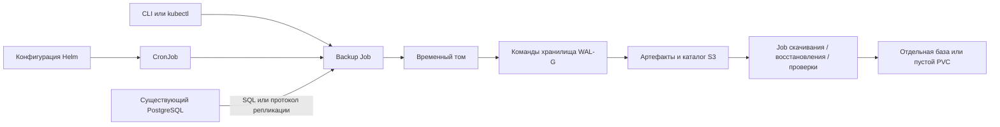

# Резервное копирование PostgreSQL в Kubernetes — спецификация разработки

**Дополнение 0.2:** [Режимы logical backup](logical-modes.md) уточняют ограничения только-custom и только-WAL-G: добавлены directory с parallel jobs и прямой поток через S3 SDK. Требования завершения, консистентности и автономного восстановления сохраняются.

Версия: 1.1  
Дата: 2026-10-09  
Статус: контракт приёмки версии 1; подтверждения реализации и открытые условия описаны в [совместимости](compatibility.md).  
Язык: русский перевод. [Нормативный английский оригинал](../en/specification.md).  
Проверка: [План тестирования](test-plan.md).

## 1. Подтверждённый объём

**REQ-001 — Продукт.** Поставить открытый Helm-чарт, образы исполнителей и CLI для резервирования нескольких существующих экземпляров PostgreSQL в существующие S3-совместимые бакеты. Источники могут быть развёрнуты через Bitnami, другой чарт, обычные Kubernetes-манифесты или находиться во внешнем managed-сервисе. Копирование одной базы и всего экземпляра PostgreSQL — разные операции.

**REQ-002 — Версия 1.** Поддержать профили `logical` и `physical-full`, ручной запуск и расписание, просмотр списка, скачивание, хранение и удаление по политике, восстановление и автоматическую проверку восстановления. Для логических профилей также доступны ручные и SQL-generated include/exclude списки таблиц (REQ-038–REQ-042). В матрицу совместимости включить PostgreSQL 14–18 и Yandex Object Storage. Политика по умолчанию: 30 дней и минимум три успешные копии на профиль. Временное хранилище настраивается, включая PVC.

**REQ-003 — Границы.** В версию 1 не входят инкрементальные/дифференциальные копии, непрерывное архивирование WAL, PITR, управление HA, создание и обновление источников, веб-интерфейс и Kubernetes-оператор/CRD. Неподдерживаемые режимы отклоняются, а не незаметно заменяются другими. Поддержка PostgreSQL 14 означает обязательство совместимости, а не утверждение о продолжающейся поддержке этой версии разработчиками PostgreSQL.

**REQ-004 — Языки и лицензирование.** Команды CLI, справка, сообщения, имена полей JSON, ключи конфигурации и исходная документация должны быть английскими. Для спецификаций и всей пользовательской документации обязательны полные русские переводы с одинаковыми версиями, идентификаторами требований/тестов и примерами. Перевод изменяется одновременно с оригиналом. Зависимости и распространяемые компоненты должны иметь открытые лицензии; формируются SBOM и уведомления о лицензиях. Предлагаемая лицензия оригинального кода проекта — Apache-2.0. WAL-G использует Apache-2.0, утилиты PostgreSQL — PostgreSQL License. Состав образов и соблюдение лицензий проверяются в M0.

## 2. Условия доступа к источнику

**REQ-005 — Без администрирования источника.** Исполнителю запрещено изменять исходные Pods, StatefulSets, Services, Secrets, PVC и Helm-релизы; монтировать тома источника; выполнять команды в его контейнерах; устанавливать расширения; создавать пользователей и права; менять постоянные настройки PostgreSQL; создавать постоянные replication slots. Допускаются локальные для соединения/транзакции настройки резервирования: read-only mode, snapshot isolation и timeouts. Учётные данные и настройки сервера предоставляются извне. Допустимы обычные запросы чтения/каталогов, операции дампа и стандартный протокол базового резервирования/репликации. Они могут вызывать чтение, checkpoints, обычные блокировки средств резервирования PostgreSQL и временное состояние репликации; нулевое влияние на нагрузку не обещается. Временный слот `pg_basebackup` разрешён только на время соединения и должен исчезать после его завершения.

**REQ-006 — Доступность логического режима.** Поддержать явно перечисленные базы по TCP, включая managed-сервисы с ограниченными административными правами. Существующие права должны покрывать подключение, схемы, таблицы, sequences, large objects и другие экспортируемые объекты. Неполный дамп или отказ доступа приводит к ошибке запуска. RLS не должен незаметно превращать полную копию базы в отфильтрованный экспорт. Базы и объекты, принадлежащие провайдеру, автоматически не включаются.

**REQ-007 — Доступность физического режима.** Нужны прямое соединение с поддержкой репликации к выбранному primary, подходящие существующие `pg_hba.conf`, `wal_level`, лимит WAL senders и доступность временных слотов, необходимых выбранному клиенту. Обычный SQL-прокси или пул соединений не является поддерживаемой физической точкой подключения. Для managed PostgreSQL гарантируется только логический режим; физический доступен после проверки реальных возможностей. Исполнитель сообщает о недостающих условиях и не пытается их исправить.

**REQ-008 — Предварительная проверка.** Проверять конфигурацию, DNS/соединение, TLS, major-версию, существование выбранных баз, доступные права, запись во временное хранилище и доступ к S3. Отличать проверку конфигурации от реального бэкапа: проверки чтения не гарантируют доступность экспорта всех объектов или успешного replication-соединения. Результат — `supported`, `unsupported` или `unverified` с английскими кодами причин. Ни предварительная проверка, ни неудачная физическая копия не переключают запуск на логический режим. Ограничения запросов метаданных не должны блокировать допустимый логический дамп managed-базы; недоступные необязательные метаданные помечаются неизвестными.

## 3. Архитектура и роли инструментов

**REQ-009 — Компоненты.** Helm-чарт создаёт CronJobs профилей, неизменяемые снимки конфигурации, ServiceAccounts, минимальный RBAC, координационные Leases и при необходимости временные PVC. Ручной запуск использует тот же Job template и исполнитель, что и расписание. CLI создаёт Jobs и читает состояние Kubernetes/S3. S3 — постоянный каталог копий; отдельная база приложения и постоянно работающий прикладной сервис не требуются. Профиль проверки по расписанию может создавать временные тестовые PostgreSQL в выделенном namespace проверки.



**REQ-010 — Инструменты.** `pg_dump` создаёт логические архивы; `pg_restore` восстанавливает их; необязательный `pg_dumpall` экспортирует глобальные объекты. `pg_basebackup` создаёт самодостаточные полные физические копии вместе с необходимыми для их восстановления WAL. `pg_verifybackup` проверяет физические копии по манифесту. WAL-G `st put` и `st get` передают полученные артефакты. Просмотр списка, HEAD-проверки, публикация каталога и удаление в ограниченной области могут использовать открытый S3 SDK.

Формат хранения определяет этот проект: это не собственный репозиторий WAL-G `backup-push`, и он не восстанавливается через `wal-g backup-fetch`. Для скачанных логических архивов используется `pg_restore`; физические архивы распаковываются и запускаются совместимым PostgreSQL. Это разделение должно явно присутствовать в справке и пользовательской документации.

**REQ-011 — Граница применения WAL-G.** Не использовать remote `backup-push` WAL-G как основной физический механизм. Возможность удалённой базовой копии сама по себе не доказывает получение всех WAL для независимого восстановления. Собственная remote-интеграция WAL-G — будущий вариант, для которого нужно доказать восстановление на фиксированной версии без изменения источника и зависимости от внешнего архива WAL. Локальные delta-копии WAL-G исключены из версии 1. В M0 проверить сохранение исходных байтов через `st put/get`, ошибки, TLS и совместимость с S3 выбранного релиза.

**REQ-012 — Версии.** Выбирать утилиты PostgreSQL той же major-версии, что указана для источника. Неожиданная major-версия сервера приводит к отказу до явного обновления конфигурации. Фиксировать runtime-образы по digest и записывать версии инструментов в каждый манифест; не устанавливать инструменты при старте Job. Начальная платформа исполнителя — Linux amd64; другим архитектурам нужны отдельные проверки совместимости. Точные версии Helm, Kubernetes, Go/runtime, minor PostgreSQL и WAL-G фиксируются в версионируемом документе совместимости на M0. Kubernetes должен поддерживать CronJob `spec.timeZone`; тестируются заявленная минимальная и актуальная поддерживаемая версии.

## 4. Контракт конфигурации

**REQ-013 — Сущности.** Разделить `targets`, `storage` и `profiles`. Target описывает endpoint экземпляра и ссылки на существующие Secrets. Profile выбирает target, один тип копии, хранилище, расписание, бюджет ресурсов, retention и необязательную проверку. Несколько профилей могут ссылаться на один target; у каждого профиля ровно один тип копии. Target имеет постоянные `sourceId` и `concurrencyKey`; псевдонимы одного источника используют общий ключ. Путь в бакете включает идентификатор установки для предотвращения коллизий между Kubernetes-кластерами.

Ниже задан предполагаемый контракт values, а не реализованный чарт. Реализация должна предоставить JSON Schema, отклонять неизвестные поля и документировать значения по умолчанию и условно обязательные параметры.

```yaml
installationId: production-cluster-a
storage:
  archive:
    bucket: pg-backups
    prefix: postgres
    endpoint: https://storage.yandexcloud.net
    region: ru-central1
    addressingStyle: path
    credentialsSecretRef: s3-backup
    tls:
      verify: true
targets:
  accounting:
    sourceId: accounting-primary
    concurrencyKey: accounting-primary
    host: postgresql.databases.svc.cluster.local
    port: 5432
    serverMajor: 17
    maintenanceDatabase: postgres
    credentialsSecretRef: accounting-backup
    tls:
      mode: verify-full
      caSecretRef: postgres-ca
profiles:
  accounting-logical:
    target: accounting
    kind: logical
    storage: archive
    logical:
      databases: [accounting]
      globals: disabled
    schedule:
      enabled: true
      cron: "0 2 * * *"
      timeZone: Europe/Moscow
      startingDeadlineSeconds: 3600
    execution:
      activeDeadlineSeconds: 21600
      resources:
        requests:
          cpu: "500m"
          memory: 512Mi
        limits:
          cpu: "2"
          memory: 2Gi
    scratch:
      type: pvc
      size: 100Gi
      storageClassName: standard
    retention:
      maxAgeDays: 30
      minSuccessfulBackups: 3
    verification:
      enabled: false
  accounting-physical:
    target: accounting
    kind: physical-full
    storage: archive
    schedule:
      enabled: false
    execution:
      resources:
        requests:
          cpu: "500m"
          memory: 512Mi
        limits:
          cpu: "2"
          memory: 2Gi
    scratch:
      type: pvc
      size: 200Gi
      storageClassName: standard
    retention:
      maxAgeDays: 30
      minSuccessfulBackups: 3
```

**REQ-014 — Secrets и TLS.** Ссылаться на существующие Secrets в namespace релиза; не копировать исходные Secrets между namespace автоматически. PostgreSQL Secret содержит `username` и `password`; S3 Secret — `accessKeyId`, `secretAccessKey` и необязательный `sessionToken`. Ссылки на CA/клиентские сертификаты задаются отдельно и документируются. Поддержать собственные CA и режимы TLS PostgreSQL, по умолчанию `verify-full`; явное отключение TLS допускается для известных внутренних источников и тестов. В production-профилях S3 проверка сертификата должна оставаться включённой. Пароли и ключи не должны попадать в values, ConfigMaps, манифесты, аргументы команд, логи или примеры. Если инструменту нужны секреты окружения или password file, использовать ограниченное монтирование/окружение только для этого процесса. Ротация Secrets применяется к новым Jobs.

**REQ-015 — Значения по умолчанию и валидация.** По умолчанию: только ручной запуск, UTC при включённом расписании без зоны, `activeDeadlineSeconds=21600`, `backoffLimit=0`, `restartPolicy=Never`, `startingDeadlineSeconds=3600`, retention 30/3, globals отключён, базы выгружаются последовательно, повторы загрузки ограничены. Размер временного хранилища и requests/limits CPU/памяти для production задаются явно; примеры не гарантируют достаточную ёмкость. Поддержать ограниченный `emptyDir`, динамический временный PVC и существующий выделенный временный PVC. Исходный PVC данных недопустим. Retention-поля должны быть положительными; пути и ID исключают выход за пределы каталога и неоднозначное совпадение префиксов. Имена баз остаются SQL-идентификаторами, а не фрагментами shell.


Очистка retention по умолчанию выполняется ежедневно в `0 4 * * *` UTC с явной настройкой расписания/приостановки. Расписания копирования и очистки независимы. При включении проверки обязательны её собственное расписание (либо только ручной запуск), целевой namespace, digest образа, resource/scratch limits и timeout. Плановая проверка при старте выбирает последнюю завершённую неудаляемую копию профиля, записывает её ID и закрепляет до окончания; она не переключается незаметно на более новую копию. Отключение проверки восстановления не отключает проверку целостности артефактов.

Каждая рабочая область scratch изолируется по run ID. Dynamic scratch PVC принадлежит запуску и удаляется после нормального завершения; сохранение после ошибки для диагностики включается явно и ограничивается. Existing dedicated scratch PVC не удаляется; конкурирующие Jobs не используют общий writable-каталог. Ownership label и настроенный allowlist определяют разрешённые scratch/restore PVC; проверку использования Pods при необходимости выполняет оркестратор с ограниченными правами. Если владение или подключение невозможно установить, операция отклоняется. Удаление API-объекта не доказывает, что удалённый узел прекратил использование тома.


## 5. Поведение резервного копирования

**REQ-016 — Логические копии.** Создавать custom-format архивы `pg_dump` для явного непустого списка баз. Необязательный выбор таблиц по базе определяется REQ-038–REQ-042; без него выгружается обычная полная база. Каждая база доступна отдельным скачиваемым файлом, но запуск завершён только после успешного экспорта всех выбранных баз и дополнительных объектов. Согласованность обеспечивается отдельно для каждой базы; единый снимок разных баз не обещается. Globals включается явно, использует `pg_dumpall --globals-only --no-role-passwords` и вызывает ошибку, если запрошен, но недоступен. В архиве сохраняются ownership/ACL; переносимое восстановление может их игнорировать. Записывать версии расширений, encoding/locale, если они доступны. Наличие бинарных файлов расширений на приёмнике остаётся условием восстановления.

**REQ-017 — Физические копии.** Использовать `pg_basebackup` с WAL streaming, созданием манифеста и обычными проверками сохранности записи. Предпочтителен tar-формат с отдельными архивами tablespaces и WAL во временном хранилище. Включать все обязательные архивы и отображения путей. Выполнять `pg_verifybackup` в формате, поддерживаемом фиксированной версией; если требуется распаковка, учитывать дополнительное место. Не отключать checksum validation или fsync ради успешного завершения. Promotion источника, смена timeline, отсутствие WAL, разрыв соединения или checksum error исключают успешную публикацию. Для запуска восстановленной копии не должен требоваться сохранённый внешний архив WAL.

**REQ-018 — Идентичность источника.** Записывать версию сервера, а для физического режима — system identifier, timeline и доступные метаданные начального/конечного LSN. Если настроенная идентичность неожиданно указывает на другой физический кластер, завершаться ошибкой до явного подтверждения в конфигурации. Отличать недоступные необязательные логические метаданные от обязательных физических условий. Проверки до и после копирования должны выявлять смену физического источника. Тестовые данные должны покрывать смену идентичности и failover; ранее завершённые копии остаются доступными независимо.

**REQ-019 — Передача данных.** До загрузки сохранить завершённый вывод инструментов во временное хранилище. Для каждого итогового объекта вычислить SHA-256 и размер. Сжатие выполняется один раз документированным этапом формирования/упаковки; передача WAL-G сохраняет байты, автоматические compression/decryption/encryption для этого контракта отключены. Будущее клиентское шифрование требует нового документированного контракта. Загружать потоком с диска при ограниченной памяти. До публикации успеха обязательны успешный exit инструмента, проверки, завершение загрузки и подтверждение удалённых размеров/контрольных сумм. Если S3-провайдер не предоставляет достоверную checksum всего объекта, повторно скачать и хешировать объект; одного ETag недостаточно.

### 5.1. Выбор таблиц для логической копии

**REQ-038 — Область применения и конфигурация.** Логические профили поддерживают исключение именованных таблиц и выгрузку только именованных таблиц. Настройка `logical.tableSelection.byDatabase` задаётся по точным именам баз, уже перечисленным в `logical.databases`. Для баз без такой настройки сохраняется обычный полный логический дамп. У каждой базы есть `mode: all | selected` (по умолчанию `all`), разделы `include` и `exclude`. Каждый раздел принимает `tables` — явный список объектов `{schema, table}`, `query` — один необязательный SQL-запрос, либо оба источника. Имена — точные идентификаторы с учётом регистра хранения в PostgreSQL; шаблоны/wildcards не поддерживаются. Схема и таблица всегда задаются отдельно, без разбора склеенного имени. Отклонять фильтры в `physical-full`, ссылки на ненастроенные базы и непустой include при `mode: all`.

**REQ-039 — Правила множеств.** Для каждой базы `I` — объединение ручного include и результата include-query; `E` — объединение ручного exclude и результата exclude-query. Дубликаты удаляются по идентичности найденного relation. В режиме `selected` итоговый список равен `I − E`. В режиме `all` используется обычная область таблиц pg_dump за вычетом `E`, с сохранением обычной обработки остальных объектов базы. Исключение всегда приоритетно, в том числе если relation вернули оба запроса. Явный выбор или исключение partitioned/inheritance parent распространяется на всех его потомков; потомки определяются через каталоги PostgreSQL на каждой поддерживаемой major-версии без зависимости от новых флагов pg_dump. Исключённый child не включается повторно через parent. Выбор leaf не включает автоматически данные ancestors или siblings.

В `selected` обязателен минимум один источник include; пустое итоговое множество вызывает `EMPTY_TABLE_SELECTION`. Нельзя убирать inclusion-аргументы и тем самым выгружать всю базу. Пустой результат exclude-query допустим. В `all` после исключений могут не остаться таблицы, но выгружаются другие объекты базы. Несуществующие имена, null/пустые идентификаторы, неподдерживаемые типы объектов и недостаточные обязательные права вызывают ошибку, включая ошибочные явные исключения; ошибки конфигурации не игнорируются. В версии 1 селекторы принимают обычные и partitioned пользовательские таблицы, включая наследуемые таблицы и partitions; views, materialized views, foreign tables, system relations и extension-owned relations через этот API не выбираются. При дампе без фильтров эти объекты обрабатываются upstream-инструментом обычным образом.

**REQ-040 — Списки из SQL.** Каждый настроенный запрос выполняется ровно один раз на базу за попытку резервирования, в этой базе с существующими credentials источника. Полученные значения не интерпретируются как SQL, shell-код или флаги pg_dump. Результат содержит ровно два текстовых столбца `schema_name` и `table_name`, по одной relation на строку. Запрос может читать доступные каталоги или пользовательские таблицы. Допустим один read-only `SELECT`, в том числе с незаписывающими CTE; до исполнения отклонять несколько statements, data-modifying CTE, `SELECT INTO`, DDL/DML и transaction-control commands. Выполнять в read-only транзакции с локальным statement timeout, по умолчанию 30 секунд, лимитом строк, по умолчанию 10 000 на запрос до дедупликации, и ограниченной памятью результата. Превышение лимита, timeout, неверный результат, SQL/permission error останавливают запуск до pg_dump, без fallback на полный дамп. Timeout и лимит строк настраиваются в `logical.tableSelection`.

SQL — доверенная конфигурация администратора. Проверка парсером и read-only транзакция не являются изоляцией произвольных функций с внешними побочными эффектами; поддерживаются только запросы без таких эффектов. На источнике не создаются stored functions, таблицы и grants. По умолчанию не логировать текст запроса, значения параметров/литералов; для аудита сохранять query/config digest и найденный список relations. Текст запроса может храниться в конфигурации релиза и не должен содержать credentials или другие секреты. Результаты базы используются только как идентификаторы, а не исполняемые инструкции.

**REQ-041 — Воспроизводимость и адаптер.** Определять оба списка и потомков partitions в одной read-only repeatable-read транзакции на базу, экспортировать её snapshot и передавать в `pg_dump --snapshot`. Сохранять транзакцию координатора до конца дампа; использовать ограниченное ожидание relation locks для защиты выбранных relations от конкурентного DDL. Если endpoint/права не поддерживают snapshot workflow, сообщать о неподдерживаемой фильтрованной копии, не ослабляя согласованность. Preflight может показать предварительный список, но исполнение всегда получает собственный список заново. Повторная попытка — новый запуск и может получить другой состав.

Преобразовывать имена в точные корректно quoted шаблоны pg_dump и передавать argv без shell. Сохранять буквальные точки, кавычки, пробелы, Unicode и wildcard-символы внутри идентификаторов. Режим только исключений реализуется точными исключениями, сохраняя обычные объекты всей базы, не являющиеся таблицами; режим selected — точными включениями и исключениями. Проверять таблицы архива относительно вычисленного множества; не завершать копию успешно при пропавших, переименованных или неожиданно включённых таблицах из-за DDL. В манифест/отчёт по базе записывать режим, ручное/query происхождение, нормализованные include/exclude/effective lists, раскрытие partitions, время определения и query digests. CLI describe и download metadata различают `full-database` и `filtered-database`; частичный архив нельзя показывать как полную копию базы. Изменения между выбором и дампом должны либо соответствовать общему snapshot и фиксированному списку, либо приводить к ошибке запуска.

**REQ-042 — Зависимости и восстановление фильтрованной копии.** Выбор исключает определение таблицы вместе с данными; исключение только данных не входит в это изменение. Не добавлять незаметно данные таблиц вне итогового множества ради зависимостей. Выбор таблиц pg_dump не гарантирует полноту зависимостей архива. Документировать внешние schemas, types, functions, extensions, parent definitions и foreign-key targets, необходимые при восстановлении; записывать известные условия и неопределённость, не обещая обнаружить все зависимости. Зависимые объекты таблиц следуют поведению pg_dump и покрываются тестами. В `selected` large objects по умолчанию исключены; явный `largeObjects: all` включает все large objects базы и должен описываться как более широкий охват, чем список таблиц. Автоматического определения принадлежности large objects таблицам нет. В `all` сохраняется обычная обработка large objects; исключение таблицы не означает исключения large objects, на которые она ссылалась.

По умолчанию логическое восстановление по-прежнему требует пустого приёмника. Для фильтрованных архивов дополнительно поддержать явный `destinationPolicy: prerequisites-only`: оператор заранее создаёт документированные schema/type/extension или referenced-table prerequisites, но восстанавливаемые relations ещё не должны существовать. Политика не перезаписывает существующие выбранные relations и не меняет источник. Dry-run/preflight сообщает об известных недостающих зависимостях; неизвестные могут вызвать явную ошибку restore. Проверки восстановления используют fixtures или явно подготовленный приёмник с нужными prerequisites, сверяют область выбранных данных и отсутствие исключённых таблиц в архиве. Тесты обычного восстановления полной базы остаются обязательными.

Примеры выбора таблиц — фрагменты логического профиля; оба примера задают нормативный предполагаемый контракт схемы:

```yaml
logical:
  databases: [accounting]
  globals: disabled
  tableSelection:
    queryTimeoutSeconds: 30
    maxQueryRows: 10000
    byDatabase:
      accounting:
        mode: selected
        largeObjects: none
        include:
          tables:
            - schema: public
              table: invoices
          query: |
            SELECT schemaname::text AS schema_name,
                   tablename::text AS table_name
            FROM pg_catalog.pg_tables
            WHERE schemaname = 'reporting'
        exclude:
          tables:
            - schema: reporting
              table: temporary_totals
          query: |
            SELECT schemaname::text AS schema_name,
                   tablename::text AS table_name
            FROM pg_catalog.pg_tables
            WHERE schemaname = 'reporting'
              AND tablename LIKE 'scratch_%'
```

```yaml
logical:
  databases: [accounting]
  globals: disabled
  tableSelection:
    byDatabase:
      accounting:
        mode: all
        exclude:
          tables:
            - schema: public
              table: application_logs
            - schema: public
              table: cache_entries
```

## 6. Запуск, параллелизм и статус

**REQ-020 — Расписание.** Создавать один CronJob на профиль с `concurrencyPolicy: Forbid` и явной IANA time zone. Профиль без расписания имеет suspended CronJob для использования как Job template. Планирование Kubernetes работает по модели at-least-once/best-effort; гарантия exactly-once или выполнения всех пропущенных запусков не предоставляется. Дубли не должны перезаписывать прежние артефакты. Записывать плановое время, если оно предоставлено Kubernetes, фактическое начало/окончание и trigger (`manual`, `schedule`, `verification`). Документировать переходы летнего времени и пропущенные scheduling deadlines.

**REQ-021 — Координация.** Последовательно выполнять копии одного источника через возобновляемый Kubernetes Lease по `concurrencyKey` в указанном namespace координации. Одного `Forbid` недостаточно для ручных Jobs и разных профилей. Конкурирующие Jobs сообщают `SOURCE_BUSY` и не начинают дамп. Если Lease нельзя продлить до истечения срока, исполнитель прекращает дочерние процессы и работу. Не перехватывать просроченный Lease, пока прежний Job потенциально активен: нужно подтверждение остановки прежнего исполнителя и дочерних процессов либо явное восстановление оператором после изоляции прежнего узла/процесса. Удаление API-объекта Job/Pod само по себе не доказывает остановку процесса при сетевом разделении. На уровне репозитория/профиля координировать retention и закрепления restore/download. Несколько установок для одного источника/репозитория обязаны использовать общую область координации; независимые писатели из разных кластеров не поддерживаются в версии 1.

**REQ-022 — Жизненный цикл.** Использовать устойчивый к коллизиям run ID на основе идентичности Job и случайной части, не одного timestamp. Последовательность: `Pending → Preflight → BackingUp → VerifyingArtifacts → Uploading → VerifyingRemote → Completed`; альтернативные конечные состояния — `Failed`, `Cancelled`, `SkippedBusy`. Каждый начавшийся запуск при ошибке получает английский reason code. Если S3 недоступен, источником информации об ошибках остаются Kubernetes status/logs. После сбоев CLI сопоставляет незавершённые записи с состоянием Jobs. `Completed` означает проверку и публикацию полного комплекта объектов, а не успешное тестовое восстановление; его статус отдельно: `not-run`, `passed`, `failed` с временем.

**REQ-023 — Повторы и отмена.** Временные ошибки S3 повторять с ограниченной экспоненциальной задержкой в пределах deadline исполнителя; по умолчанию пять попыток на операцию. Не повторять ошибки аутентификации/конфигурации и не продолжать незаметно неудачный дамп. Новая попытка всего запуска получает новый ID. При завершении отменить дочерние процессы и загрузку, освобождать координацию только после остановки процессов, не публиковать успех. По возможности прерывать собственные multipart uploads; документировать внешнее bucket-правило очистки незавершённых uploads после потери узла. Явная отмена CLI должна оставлять доступный статус. Недоступность API и сетевые разделения не должны разрешать одновременную работу с источником.

## 7. Каталог S3 и retention

**REQ-024 — Структура.** Использовать существующий бакет и точную область имён:

```text
<prefix>/v1/<installationId>/<sourceId>/<profileId>/
  runs/<runId>/artifacts/<opaque-file-id>
  runs/<runId>/manifest.json
  runs/<runId>/complete.json
  events/<runId>/<event-id>.json
  verification/<runId>/<verification-id>.json
```

Непрозрачные file IDs исключают превращение небезопасных имён баз в пути файловой системы. Манифест связывает ID с именами баз, файлов, размерами, SHA-256, форматами, версиями источника/инструментов, временем, типом копии, tablespaces, условиями восстановления и digest конфигурации без секретов. Поле `schemaVersion: 1` обязательно. Маркер успеха включает digest манифеста и загружается последним одним объектом. Он ссылается только на неизменяемые артефакты. CLI показывает пригодные копии только при валидных маркере/манифесте; неполные запуски доступны в диагностическом списке. Потерю ответа после публикации разрешать чтением маркера без повторного дампа и удаления корректной копии.

**REQ-025 — Провайдеры S3.** Поддержать настройку endpoint, region, bucket, prefix, addressing style, TLS CA и постоянных/временных учётных данных. Одинаковый формат должен работать в AWS S3-совместимом хранилище и Yandex Object Storage; сертификация провайдеров записывается отдельно. В M0 подтвердить точное отображение настроек на WAL-G. Можно использовать серверное шифрование бакета; специфические encryption headers провайдера поддерживать только после интеграционного теста. Не создавать и не перенастраивать бакеты, IAM-роли или lifecycle. Физические копии могут содержать конфигурационные файлы источника и считаются конфиденциальными данными.

**REQ-026 — Retention.** Отдельная операция очистки по расписанию/вручную на профиль. Завершённая копия удаляема только если старше `maxAgeDays` И не входит в последние `minSuccessfulBackups` по времени завершения. Не удалять активные, закреплённые или используемые проверкой/восстановлением/скачиванием копии. Перед удалением артефактов создать запись удаления и убрать маркер успеха под координацией; прерванное удаление возобновляется идемпотентно. Незавершённые копии удаляются только после настраиваемого grace period, по умолчанию семь дней, и подтверждения остановки писателя. Удаление ограничено проверенными точными префиксами запусков. Object Lock/запрет удаления создаёт видимую ошибку очистки, не меняя статус успешного бэкапа на ошибочный. Helm uninstall сохраняет удалённые объекты.

## 8. Скачивание, восстановление и проверка

**REQ-027 — Скачивание.** CLI скачивает выбранный завершённый запуск или архив одной логической базы по ID, проверяет маркер/манифест и SHA-256, безопасно сохраняет имена файлов. Локальная цель должна быть пустой либо явно выбранным неконфликтующим путём. Восстановление скачанных артефактов возможно без исходного Kubernetes-кластера и сервиса каталога приложения. Для каждой версии формата поставляются инструкции восстановления стандартными инструментами. Скачивание может выполняться Job в целевой PVC, чтобы не передавать S3-секреты на локальную машину.

**REQ-028 — Логическое восстановление.** Выбранный архив восстанавливается в явно указанную отдельную базу с отдельными учётными данными. По умолчанию нужна пустая цель (с явным исключением для filtered restore из REQ-042) и `pg_restore --no-owner --no-acl --exit-on-error`; произвольное разрушающее clean/drop не входит в версию 1. Сохранение ownership/ACL — отдельный явный режим с необходимыми ролями приёмника. Globals никогда не исполняются автоматически. Требовать подтверждение идентичности приёмника, отклонять настроенные endpoints источников и обнаруженное совпадение идентичности источника/приёмника. Из-за DNS-псевдонимов одной проверки адреса недостаточно; приёмники должны административно выделяться как изолированные цели восстановления. Ошибка может оставить часть объектов: сообщать об этом и требовать заново очищенную цель для повтора.

**REQ-029 — Физическое восстановление.** Восстанавливать в явно выбранный пустой выделенный PVC при остановленном PostgreSQL. Проверить хеши, исключить traversal путей архивов, распаковать data/WAL/tablespaces с явным отображением и проверить совместимость major-версии, архитектуры/сборки и требований расширений. Не перезаписывать работающий источник и не подключать его PVC. Обезвредить восстановленные connection/recovery settings, чтобы тестовый экземпляр не присоединился к репликации источника и не запускал его архивирование; сохранить аудит изменений настроек восстановления без вывода секретов. Конфигурация вне PGDATA и бинарные файлы расширений — отдельные условия развёртывания. Результат продукта — подготовленный каталог данных и отчёт; production-развёртывание выполняет оператор отдельно. Автопроверка запускает временный совместимый сервер на подготовленных данных.

**REQ-030 — Проверка восстановления.** Ручные и плановые проверки обоих типов выполняются в изолированной среде. Указать бюджеты ресурсов/диска, совместимый выбираемый пользователем образ PostgreSQL по digest и deadline. Проверять запуск/соединение, схемы, таблицы, индексы, ограничения, sequences, large objects и ожидаемые данные тестового набора в пределах объявленной области архива. Для filtered archives применяются правила зависимостей и проверки REQ-042; дополнительные пользовательские assertions чтения необязательны. Физическая проверка должна проходить при недоступных источнике и внешнем архиве WAL. Отчёты с версиями образов/инструментов и результатами сохраняются в S3. Ошибка проверки сигнализируется отдельно от ошибки бэкапа, не изменяет источник и не удаляет копию. Временные ресурсы очищаются по настраиваемому TTL для диагностики ошибок.

## 9. CLI, эксплуатация и развёртывание

**REQ-031 — Контракт CLI.** Предоставить `pgbk config validate`, `pgbk preflight`, `pgbk backup run`, `pgbk backup list`, `pgbk backup describe`, `pgbk backup download`, `pgbk backup cancel`, `pgbk restore logical`, `pgbk restore physical`, `pgbk verify`, `pgbk retention run`. Изменяющие операции требуют явных profile/destination; неявной production-цели восстановления нет. Поддержать читаемый английский вывод и версионированный `--output json`, стабильные exit codes: 0 успех; 2 некорректный ввод; 3 неподдерживаемый режим/недостающие условия; 4 занято; 5 ошибка исполнения; 6 ошибка целостности; 7 отмена; 8 ошибка аутентификации/авторизации. Stderr инструментов очищается от секретов и включается в структурированные ошибки. CLI поддерживает явные Kubernetes context/namespace и timeout. Документировать эквивалентные ручные команды `kubectl create job --from=cronjob/...`. Команды описывают проектный контракт, а не уже существующие бинарные файлы.

**REQ-032 — Наблюдаемость.** Структурированные JSON-логи содержат run/profile/source IDs, фазу, длительность, объём, trigger и reason code. JSON `backup list/describe` пригоден для мониторинга последнего успеха, возраста копии, длительности, ошибок, ошибок очистки и статуса проверки восстановления. Добавить примеры alerts по просроченной свежести копий и неудачной проверке. Метрики только короткоживущего Job недостаточны для контроля свежести: документировать опрос постоянного каталога или подходящую внешнюю интеграцию мониторинга. Не логировать секреты, DSN с паролями, содержимое дампов и access tokens.

**REQ-033 — Helm и RBAC.** Чарт содержит `values.schema.json`, описание values, overrides/digests образов, настройки ресурсов и размещения, TTL/history, labels, необязательные NetworkPolicies и Secret references. Безопасность исполнителя по умолчанию: non-root, read-only root filesystem, dropped capabilities, выделенное writable scratch. Доступ исполнителя ограничивается объектами координации и необходимым Job status; запрещены широкое чтение Secrets через API, exec в source Pods, cluster-admin и изменение source workloads. Оркестрация проверки/восстановления использует отдельные явно включаемые ServiceAccounts/Roles в выделенных namespace. Helm upgrades влияют на новые Jobs через неизменяемые ссылки конфигурации; работающие Jobs сохраняют свою конфигурацию. Chart hooks не запускают бэкап/восстановление неявно. Uninstall не удаляет существующие Secrets/PVC или S3-данные; владение временными PVC и их очистка документируются.

**REQ-034 — Ресурсы и ограничения отказов.** Один источник обрабатывается последовательно; разные источники могут выполняться параллельно в пределах бюджетов профилей, с возможным разнесением расписаний. Не обещать универсальные throughput, compression ratio, RPO или RTO. Измерять репрезентативную длительность копирования/восстановления в CI или benchmark-среде и публиковать данные об объёме, оборудовании и версиях. Учитывать место артефактов, распаковки для проверки и восстановления; ясно сообщать об исчерпании диска. Не буферизовать всю копию в RAM. Шесть часов — настраиваемый deadline по умолчанию, а не гарантия доступности.

## 10. План поставки и документация

**REQ-035 — Этапы.** Реализовать в следующем порядке:

| Этап | Результат и условие завершения |
|---|---|
| M0: реализуемость | Зафиксировать версии и лицензии; доказать WAL-G raw transfer, самодостаточное восстановление pg_basebackup, логический экспорт managed-источника с минимальными правами и S3 checksum strategy; зафиксировать CLI/schema и матрицу совместимости. |
| M1: каталог и исполнитель | Валидация конфигурации, изоляция процессов, манифесты/маркеры, S3 adapter, блокировки, отмена, retention и тесты внедрения отказов. |
| M2: логический режим | Дампы нескольких баз, ручной/SQL выбор таблиц, необязательные globals, managed-ограничения, логическое восстановление, проверки целостности и восстановления. |
| M3: физический режим | Полные копии с WAL/tablespaces, проверка соответствующей версией, изолированное восстановление в PVC, тесты failover/ошибок. |
| M4: Kubernetes | Helm-чарт, ручной/плановый CLI, RBAC, lifecycle временного хранилища, координация Jobs, end-to-end в kind. |
| M5: выпуск | Матрица PostgreSQL 14–18; живой тест Yandex; пакеты CLI/образов/чарта; SBOM; английские/русские документы; все условия приёмки выполнены. |

Предлагаемая реализация — Go CLI/worker, запускающий фиксированные upstream-утилиты как subprocesses, Helm templates и открытые S3/Kubernetes client libraries. M0 может выбрать другой язык только через документированное архитектурное решение, сохраняющее требования. Структура репозитория разделяет chart, runner/CLI, adapters, tests/fixtures и двуязычную документацию.

**REQ-036 — Обязательная пользовательская документация.** На английском и русском: quickstart; справочник конфигурации; включение/исключение таблиц с ручными и SQL-примерами, правилами partitions и условиями filtered restore; условия источников generic Kubernetes/Bitnami/managed PostgreSQL; S3/Yandex setup; запуск вручную/по расписанию; скачивание; логическое и физическое восстановление; проверки; retention; troubleshooting по reason code; права/TLS; планирование ресурсов; совместимость и обновление. Примеры используют placeholders и синтетические данные. Не создавать впечатление, что чарт настраивает существующий источник или managed-провайдера. Каждый PR с изменением поведения обновляет оба языка и соответствующие тесты.

**REQ-037 — Готовность.** Каждому требованию соответствует реализованная возможность либо явная граница версии 1 и тесты сопутствующего плана. Обязательные release-тесты пройдены, отчёты сохранены. Копии восстанавливаются из S3 при недоступном источнике. Изменений конфигурации или развёртывания источника нет. Managed logical backup работает без superuser. Документы двух языков синхронизированы. Неподдерживаемые возможности, ограничения прав, условия восстановления и непроверенные провайдеры явно обозначены. Успешных uploads недостаточно для объявления production-ready.

## 11. Источники и обоснование

Источники проверены 2026-10-09; в M0 проверяются фиксированные релизы, а не предполагается поведение development-веток.

- [PostgreSQL pg_dump](https://www.postgresql.org/docs/current/app-pgdump.html): логический экспорт, форматы архивов, точный выбор таблиц и ограничения зависимостей.
- [PostgreSQL pg_basebackup](https://www.postgresql.org/docs/current/app-pgbasebackup.html): replication-условия, включение WAL, tablespaces и физические форматы.
- [PostgreSQL pg_verifybackup](https://www.postgresql.org/docs/current/app-pgverifybackup.html): проверка манифестов и её ограничения; она не заменяет тестовое восстановление.
- [WAL-G PostgreSQL](https://wal-g.readthedocs.io/PostgreSQL/): локальный/удалённый режимы и ограничения удалённых delta-копий.
- [Команды хранилища WAL-G](https://wal-g.readthedocs.io/StorageTools/): загрузка/скачивание файлов и флаги преобразований.
- [Реализация WAL-G streaming](https://github.com/wal-g/wal-g/blob/master/internal/databases/postgres/streaming_base_backup.go): код для проверки реализуемости собственного remote-режима.
- [Kubernetes CronJobs](https://kubernetes.io/docs/concepts/workloads/controllers/cron-jobs/): расписание, часовые пояса и область concurrency policy.

Описанные проектные политики, формат каталога, правила безопасности и критерии приёмки являются требованиями к разработке, а не утверждением, что upstream-инструменты уже реализуют их.
